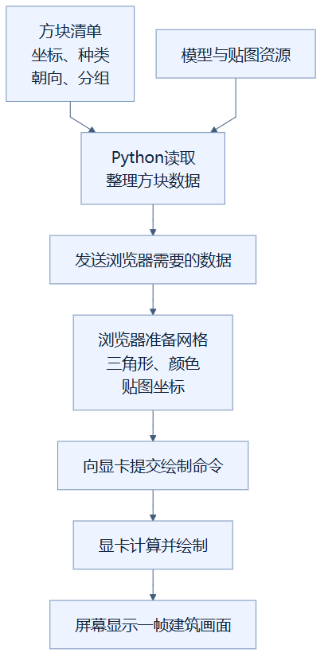
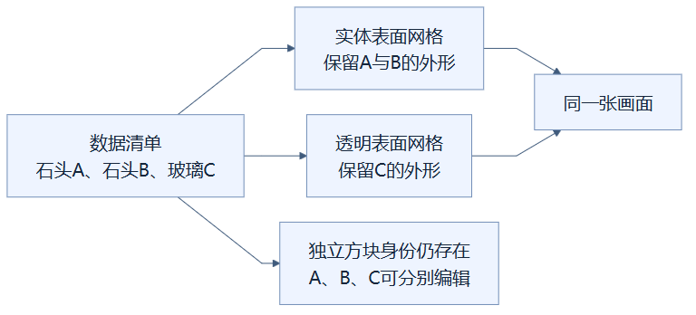
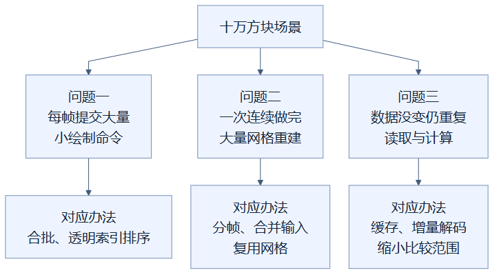

# 00：屏幕里的建筑是怎样画出来的

**先记住一句话：建筑数据是一份“哪里放什么方块”的清单，渲染则是把这份清单变成屏幕上的一张图。** 本篇介绍基础概念；它不是另一项新优化。

## 先用搭积木来理解

想象你设计了一座积木城堡。你有一份清单：坐标（3，5，8）放石头，坐标（4，5，8）放朝东的楼梯，坐标（5，5，8）放蓝色玻璃。

清单可以保存、修改、撤销和导出，但“清单已经存在”不等于“画面已经画好”。程序还要找到这些积木的外形和贴纸，决定哪些表面能看见，处理玻璃的前后关系，再交给显卡绘制。

清单在这里对应**方块数据**；积木外形对应**模型**；贴纸和颜色对应**贴图、材质**；准备交给显卡的一堆三角形对应**网格**。真实的渲染流程还包含光照等工作，所以这个类比只解释几个主要环节。

从上往下读图：只有走完后面的步骤，你才真正看见建筑。保存方块清单与绘制画面是不同工作，这也是为什么后端缓存和前端合批会分别出现。

## 方块为什么变成了三角形

显卡通常用三角形表示表面。一个普通立方体有六个面，每个四边形可以拆成两个三角形。楼梯、植物、玻璃板的外形不同，需要的表面也不同；被邻居完全挡住的面还可以省去。

**网格**就是准备好的一组顶点与三角形。顶点可以理解为表面的角点。**材质**告诉程序怎样画这些表面，例如使用哪张贴图、是否透明、是否发光。把很多表面合进一个网格，并不等于把数据库里的多个方块合成一个方块。

图中用一个简化的小场景说明这个区别，数量只作示意：

图里A和B虽然可以一起提交绘制，编辑时仍能分别处理。后面的第04篇会说明：鼠标点到合并网格的一块三角形后，程序怎样找回它对应的方块。

## 十万个方块为什么可能卡顿

你可以把CPU想成安排工作的人，把GPU（显卡中的图形处理器）想成负责绘画的工人。CPU不仅要准备材料，还要不断发送绘制命令。工人画得快，如果安排者每帧发出几万条小命令，安排本身也可能拖慢进度。

这些命令叫**绘制调用**，英文是draw call。一次调用可以画许多方块的表面，一个方块也可能参与多次调用，所以它和方块数量不是一对一关系。

另一类卡顿来自浏览器的**主线程**。主线程可以理解为处理许多页面工作的主要执行路线：事件处理、部分页面更新和我们写的网格重建都会占用它。如果一次网格重建长时间不让出执行机会，鼠标和页面响应就可能延后。

三个问题发生在不同地方，因此需要不同办法。第一类主要改善持续旋转；第二类主要改善切层和编辑时的响应；第三类主要减少刷新和局部修改中的重复处理。单独解决一个问题，其他问题仍可能存在。

## 流畅、立即完成，是两件事

**一帧**是一张更新后的画面。60 FPS表示每秒约60张，换算下来每张约16.7毫秒。相邻画面的时间叫**帧间隔**；它包含浏览器的实际调度情况，不等于某一个函数的执行时间。

如果一个修改总共需要500毫秒，但程序把准备工作拆开，中途仍能响应相机，你会感觉“等待结果，但页面没冻结”。如果500毫秒连续霸占主线程，你可能感觉“整个页面卡住了”。两者完成时间可能相近，使用体验却不同。分帧重建主要改善后者，不保证缩短总等待。

实验中的P95表示约95%的样本不超过该值。例如P95为16.8毫秒，并不意味着最长一帧也是16.8毫秒；剩下的少量帧可以更慢。因此说明文档还会保留最长帧、首次载入和操作等待。

## “分块”与“缓存”到底是什么

**分块**是在空间里划出小区域。本项目每个分块覆盖16×16×16个整数坐标位置，最多4096个位置，但区域里可能有空气，不一定真的有4096个非空气方块。分块方便局部更新：修改一个角落时，先找对应小区域及必要邻居。

**缓存**是临时保留算好的结果，下一次符合条件时直接使用。它像提前整理好的笔记。笔记过期了就必须重算；笔记太多了就要淘汰一部分。缓存不是权威建筑数据，SQLite数据库仍负责保存真实项目。

浏览器负责把数据变成画面，我们称它为**前端**。Python负责读写、编辑规则、历史和数据准备，我们称它为**后端**。第01–10篇主要讲前端，第11–14篇主要讲后端，两边的优化互相配合。

## 带着这些问题往下读

看到“合并”时，问：合并的是绘制工作，还是方块数据？看到“缓存”时，问：怎样发现旧结果过期？看到“局部更新”时，问：邻居会不会受影响？看到“更流畅”时，问：改善的是每帧，还是点击后等待时间？

这些问题比记住函数名更重要。每篇图解都会给出答案和测试证据，全部历史实验可查 [优化实验记录](../RENDERING_OPTIMIZATION_LOG.md)。

## 读懂了吗

问题：同一类石头被合成一个大网格，是否意味着以后不能单独删除其中一块？

答案：不是。合并的是用于绘制的表面数据，原始方块清单仍保留各自坐标与身份；程序还保留从三角形找回所属方块的信息。合批必须同时维护这两件事，才能既快又能正确编辑。

[返回总目录](README.md) · [下一篇：不透明方块合批](01-opaque-batching.md)

<!-- diagram-sources -->

图示源文件：[图1](../../figures/rendering-guide/00-start-here-01.md) · [图2](../../figures/rendering-guide/00-start-here-02.md) · [图3](../../figures/rendering-guide/00-start-here-03.md)。
