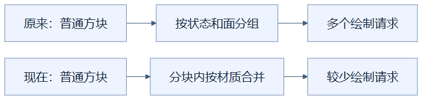
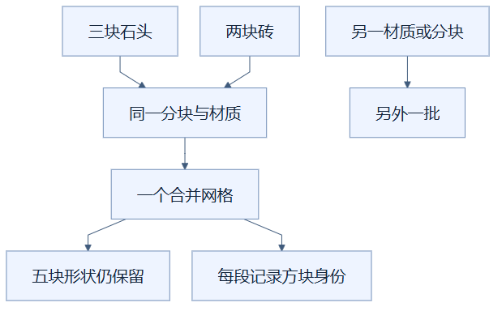

# 01：把普通方块按材质合批绘制

把能用同一种绘制设置的普通方块集中交给显卡，可以减少反复发出绘图指令的开销。（状态：已采用，树叶保留专门路径。）

## 先用送餐理解

一家餐厅要送五份餐，每份都派一辆车，发车、登记、停车会重复五次；同路的餐装到一辆车，餐本身没有少，运输手续却减少了。这里，每份餐对应一个方块的几何数据，车辆对应一次绘制调用，也就是程序向显卡发出的绘图请求。合批减少的是请求次数。

这个比喻只解释“集中提交”，不表示把五份餐揉成一份。项目仍保留每个方块的形状、纹理和身份；也不会为了合批把楼梯变成立方体。

## 实际合并的是什么

几何数据记录模型的顶点、表面朝向、颜色和纹理坐标；材质规定这些表面怎样绘制，例如使用什么纹理、是否发光。材质不是方块名称。纹理图集把多种小图片放进一张大图，因此石头和砖块也可能使用同一个材质。

此前按方块状态和可见面组合组织绘制，组合越多，请求越多。现在仍先复用这些组合的模型模板，再在每个边长为 16 格的分块内，把多数非半透明部件按实际材质合成几何网格。几何网格就是可提交绘制的一组表面。

上方表示原来的分组粒度，下方表示当前多加的一层材质合并。两条路径都画出原有模型；区别在于向显卡提交多少组数据。

举例说，同一分块有三块石头和两块砖，五块都使用同一材质与图集，就能放进一个合并网格。若其中一块使用独立发光材质，或位于另一分块，它会归入另一批。合并函数先计算总顶点数，一次分配数组，再把每块的局部坐标加上它的世界位置；同时记录每段三角形属于哪个方块。

石头和砖汇入同一节点，是因为绘制设置相同，并非名字相同。网格同时保留形状与身份，后续点击仍能找到原方块。

## 适用与代价

这种办法适合“方块很多、状态组合很多、材质相对少”的场景。它没有进一步把相邻面拼成大面，也没有减少模型细节；遮挡面仍按原来的规则先剔除。显卡需要处理的可见三角形因此不一定减少，主要收益是降低提交开销。

代价是合并后要保存各方块的顶点副本，比只保存模板和位置矩阵更占内存，重建也要复制数组。当前 `cutout` 层的树叶是例外：`cutout` 指贴图空洞被直接裁掉的绘制层。为减轻共面叶片的画面差异，树叶仍按状态和可见面使用实例网格，也就是共享形状、分别保存位置。不能把资源中的 `cutout` 标签直接理解成“全部都走树叶路径”。

## 怎样判断做对了

绘制调用减少只能说明提交变少，还要检查实际表面是否齐全、纹理是否正确、点击是否返回原身份。最终组合实现的十万格场景记录了 29,596 到 243 次调用的变化，但前后帧率采样时长不同，且树叶、透明处理和其他改进一起参与结果，不能把最终流畅度单独归功于本项。

严格逐像素一致的验收尚未通过。现有几何覆盖、点选和截图检查支持已测场景正确显示，但不证明任意视角完全相同。

实现见 [viewer.ts](../../frontend/src/viewer.ts) 的 `rebuild` 与 [chunkGeometry.ts](../../frontend/src/chunkGeometry.ts) 的 `mergedChunk`；测量条件见 [优化记录](../RENDERING_OPTIMIZATION_LOG.md)。

## 读懂自检

**问：五块方块合成一个网格，是否说明它们变成了一个方块？**

答：没有。合并的是绘制数据和提交方式，五块的形状、位置及三角形归属仍分别保存。

[返回总目录](README.md)

<!-- diagram-sources -->

图示源文件：[图1](../../figures/rendering-guide/01-opaque-batching-01.md) · [图2](../../figures/rendering-guide/01-opaque-batching-02.md)。
