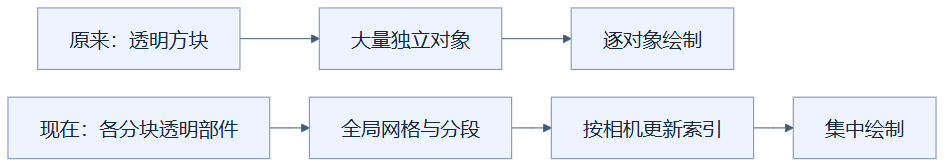
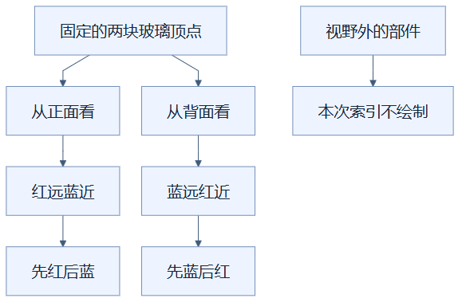

# 02：让半透明表面按远近排队

把半透明表面集中管理，并随相机位置调整绘制顺序，可以减少绘制请求，同时保留必要的透视叠加关系。（状态：已采用，属于排序近似而非逐像素精确方案。）

## 先用彩色薄膜理解

想象在白纸上依次盖红色和蓝色透明薄膜。后盖的薄膜会与下面已有颜色混合，交换顺序，颜色就可能改变。玻璃表面的透明度混合也依赖先后顺序：通常要先画远处，再画近处。

这里，薄膜对应透明表面，摆放顺序对应绘制顺序，观察位置对应相机。比喻到这里就结束了：真实模型有前后两面、交叉形状和被墙遮住的部分，不能只按两张平纸处理。

## 为什么需要全局排序

普通实体可以先画，再靠深度判断保留最近表面。深度是某个表面相对于相机的远近记录。透明表面还要混合后方颜色，因此当前材质关闭深度写入，但仍接受已有实体深度的遮挡判断。

如果每个分块各自排好透明方块，分块之间的前后关系仍可能错。当前将不同分块的半透明部件放进统一网格，每个部件保存一段顶点范围。索引缓冲是一份“按哪个顶点编号画”的清单；排序时改清单，不搬动已经保存的顶点、纹理和颜色数组。

上方展示原先依靠许多独立对象绘制的方式。下方把表面数据集中保存，但通过索引保留了调整先后顺序的能力。

相机投影与视图矩阵没变化时，排序函数直接返回；它们描述相机如何把世界映射到画面。变化时，程序先用包围球粗略判断部件是否进入视野，再按部件中心的深度从远到近排列。同深度时保留稳定次序；每段内部还先排背面，再排正面，以接近此前双面透明材质的两次绘制顺序。

## 一个小例子

红玻璃在相机前方较远处，蓝玻璃在近处，索引先列红色，再列蓝色。相机绕到建筑另一面，远近关系反过来，清单也反过来；玻璃的顶点位置并没有移动。

两条分支表示同一份几何数据在两种观察方向下使用不同清单。右下角的跳过只影响本次绘制，部件数据仍在场景里，转回来还能显示。

## 适用、代价与验证边界

这种方案适合透明方块较多、原先每块都产生绘制开销的场景。文字等部件使用不同材质时，索引还会划分材质组，因此“统一网格”不等于所有内容永远只有一次绘制调用。

相机移动会增加处理器上的可见性判断、排序和索引更新成本。它按部件中心排序，不逐像素决定先后；长形表面互相穿插时，中心顺序可能无法表达所有区域的真实关系。不能把它称为完全消除透明错误的算法。

检查时应固定相机比较玻璃颜色、遮挡和内部可见性，再改变观察方向。性能计时要包含排序：当前 `drawNow` 先排序，再调用绘制函数，只计后者会漏掉处理器工作。已有透明样例仍出现超出严格像素容差的差异；实际几何、点选和截图核验通过，也不能替代逐像素证明。最终帧率属于组合实现。

实现见 [transparency.ts](../../frontend/src/transparency.ts) 的 `sort` 和 [viewer.ts](../../frontend/src/viewer.ts) 的 `drawNow`；条件与限制见 [优化记录](../RENDERING_OPTIMIZATION_LOG.md)。

## 读懂自检

**问：旋转相机后，为什么只换顶点编号清单就能调整玻璃顺序？**

答：玻璃的位置没有变，需要改变的是先画哪段表面；索引清单正好规定这个顺序。

[返回总目录](README.md)

<!-- diagram-sources -->

图示源文件：[图1](../../figures/rendering-guide/02-transparent-order-01.md) · [图2](../../figures/rendering-guide/02-transparent-order-02.md)。
