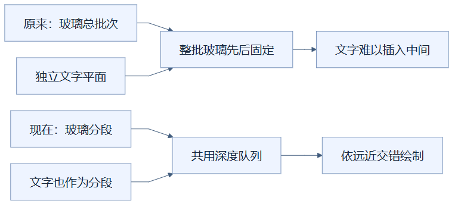
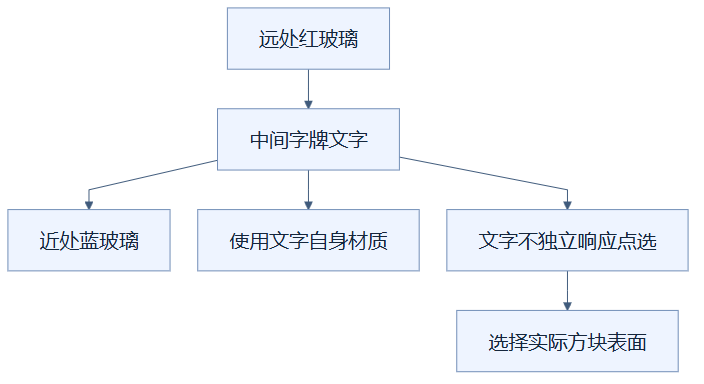

# 03：让字牌文字与玻璃共享排序

把字牌文字放进与玻璃相同的远近队列，可以修复透明合批后文字遮挡关系不正确的问题。（状态：已采用的正确性修复。）

## 先用橱窗告示理解

站在橱窗前，远处有一块红玻璃，中间有告示文字，近处有一块蓝玻璃。如果先画完所有玻璃，再把文字贴到最上面，文字就像浮在橱窗外；如果先画文字再画所有玻璃，远处玻璃也可能错误覆盖它。

告示对应字牌文字表面，两块玻璃对应半透明方块，橱窗中的距离对应相机深度。比喻说明的是三者必须共同排队，不表示文字与玻璃使用相同颜料或相同材质。

## 问题为什么出现

字牌的木板和文字是不同绘制部件。文字先画在小画布上，再变成纹理图片，贴到一个平面上。这个平面带有透明区域，原先是独立网格，也就是单独管理的一组表面。

玻璃改为全局合并后，若文字仍独立绘制，绘制器无法把文字插入大玻璃网格的中间。仅调高或调低整个文字对象的绘制优先级，不能同时满足“在远玻璃前、在近玻璃后”的关系。

上方的两种对象分别提交，文字只能相对于玻璃整批排队。下方改为按部件排队，文字可以插入两块玻璃之间。

## 当前怎样修复

刷新透明批次时，程序寻找标记为 `signText` 的文字网格，把它隐藏，避免重复绘制。随后复制它的材质，将文字几何展开成可合并的三角形数据，补齐表面朝向和白色顶点颜色，再交给全局透明管理器。

材质是表面绘制的设置集合。文字保留自己的纹理与材质，不会换成玻璃的图片；统一索引清单遇到不同材质时，分成相应绘制组。原文字对象继续持有原纹理的生命周期，隐藏并不等于已经释放。

例子中正确的顺序是“远红玻璃 → 文字 → 近蓝玻璃”。文字表面设为不可独立点选，点击仍选中支撑字牌的方块，而不是把某个笔画当作新的方块。

主竖线表示远到近的绘制顺序，旁边分支说明文字的额外规则。共享队列只统一排序，没有抹掉它的材质，也没有为文字制造新的编辑身份。

## 适用、代价与验证边界

这项修复适合含有可渲染字牌文字、并有玻璃遮挡关系的场景。每种文字纹理与材质仍可能增加绘制组，额外材质也需要释放；透明管理器释放复制的文字材质，原分块负责原文字纹理与材质，临时展开几何在合并后释放。

它解决排序衔接问题，不会让不支持的导入格式自动获得字牌内容。用户别墅的旧格式曾仅做方块状态投影：原始附件虽然保存，渲染器没有从中读取字牌文字。该建筑的截图因此不能证明原字牌已正确显示；字牌验证使用可支持格式中的实际文字数据。

应使用“文字夹在两块不同颜色玻璃之间”的专门样例，从多个方向比较，再核验点击返回的方块身份。现有严格像素验收仍有透明差异，本项也没有独立帧率收益数据；它首先保证合批后的行为合理。

实现见 [viewer.ts](../../frontend/src/viewer.ts) 的 `flushTransparency`、[transparency.ts](../../frontend/src/transparency.ts) 和 [signText.ts](../../frontend/src/signText.ts)；导入与像素边界见 [优化记录](../RENDERING_OPTIMIZATION_LOG.md)。

## 读懂自检

**问：把文字加入透明队列，是否应该把原文字网格也继续画出来？**

答：不应该。原网格被隐藏，由合并后的文字分段负责绘制，否则会重复显示；原对象仍承担原资源的释放责任。

[返回总目录](README.md)

<!-- diagram-sources -->

图示源文件：[图1](../../figures/rendering-guide/03-sign-order-01.md) · [图2](../../figures/rendering-guide/03-sign-order-02.md)。
