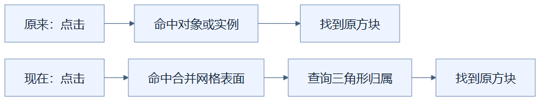
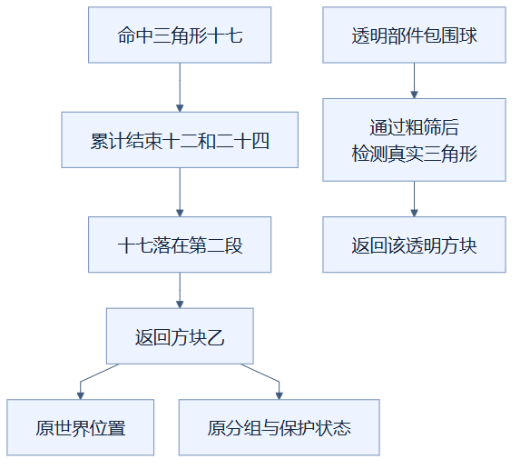

# 04：合批后仍能点中原来的方块

把绘制数据合并后，记录每段三角形的方块归属，点击仍能返回原方块的位置、分组和保护状态。（状态：已采用的合批配套机制。）

## 先用装箱清单理解

多个商品装进同一个大箱子，箱子少了，但售后不能只回答“你买的是这个箱子”。装箱清单要记录第几件属于哪个订单。合并网格是大箱子，三角形是箱内商品，方块身份表是清单。

这个比喻说明合并后仍需追溯身份。真实点击还必须先判断鼠标指向哪个表面，并不是拿一个箱子的外边界代替所有商品形状。

## 从鼠标到真实表面

射线检测可以理解为从相机穿过鼠标所在画面位置，向场景发出一条看不见的线，寻找它最先碰到的三角形。三角形是模型表面的基本单元；楼梯、薄玻璃和半砖都由各自实际表面组成。

独立对象或实例网格原本可以通过对象、实例编号找方块。现在普通合并网格记录每个部件的三角形累计结束位置，再用命中三角形的编号反查归属；实例路径仍使用实例编号，透明批次另有分段检测。

两条路径最终都返回方块身份，下方多了一步从三角形查清单。合批改变对象组织方式，没有改变编辑所需的方块信息。

## 一个小例子

假设方块甲、乙各贡献 12 个三角形，累计结束位置是 `[12, 24]`，编号从 0 开始。命中编号 17，它位于 12 到 23，所以属于乙。程序用二分查找缩小区间，不必从清单第一项一直找到底；若网格使用重排后的索引，先还原三角形编号，再查归属。

上半部分展示具体编号如何恢复乙的身份。下半部分是透明部件的另一条检测路径：包围球只负责排除明显碰不到的部件，最终仍测真实表面。

透明全局网格依次检查可点选部件，先判断射线是否穿过包围球、是否超过允许距离，再只检测该段三角形。文字分段不参与独立点选。整场几何重建期间，点击直接返回空结果，避免在半新半旧的画面里执行编辑。

## 适用、代价与验证边界

这种机制适合绘制合批后仍需要精确定位方块的编辑器。它不是把每个占用格都当成完整立方体，因此点击薄片旁边的空隙不会自动命中整格；也不是沿格子逐步行走的体素算法。代价是保存归属数组，并在点击时执行模型表面检测；透明部件很多时，粗筛本身也有成本。

命中法线表示表面朝向，当前程序取其中最显著的一个坐标轴作为放置方向。因此楼梯斜面不一定返回精确斜向法线。贴图上的透明像素也不保证逐像素穿透点选。没有方块命中时，还会尝试地面平面，返回用于地面放置的坐标。

验证应同时核对场景数据、实际几何归属和真实画布点击。仅证明数据库里有某方块，不能证明它被画出；仅看到正确外观，也不能证明点击返回正确保护状态。现有点选通过的结论只覆盖已测模型与视角，最终帧率来自组合实现。

实现见 [chunkGeometry.ts](../../frontend/src/chunkGeometry.ts) 的 `triangleOwner`、[viewer.ts](../../frontend/src/viewer.ts) 的 `pick` 与 [transparency.ts](../../frontend/src/transparency.ts)；验证见 [优化记录](../RENDERING_OPTIMIZATION_LOG.md)。

## 读懂自检

**问：射线穿过玻璃部件的包围球，能立刻认定点中了玻璃吗？**

答：不能。球只是粗略范围，还要检测真实三角形，才能避免把范围内的空隙当作表面。

[返回总目录](README.md)

<!-- diagram-sources -->

图示源文件：[图1](../../figures/rendering-guide/04-block-picking-01.md) · [图2](../../figures/rendering-guide/04-block-picking-02.md)。
