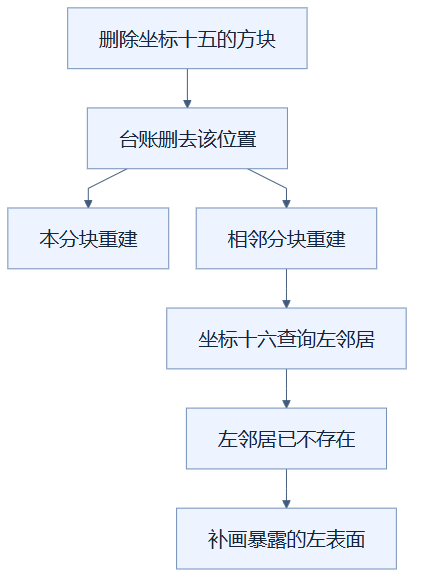

# 05：只更新发生变化的位置索引

持续保存“哪个位置有什么方块”的索引，并只更新变化分块，可以避免每次操作都重新扫描整个场景。（状态：已采用。）

## 先用仓库台账理解

仓库每次只换一个货架的商品，如果都重新盘点全仓库，工作量会随库存增长。维护一本位置台账，移走旧商品时删掉记录，放入新品时写入记录，就能直接查询某个格位有没有东西。

货架对应分块，商品对应方块，位置台账对应占用索引。这个比喻只说明索引维护；真实项目还要处理相邻方块遮挡，以及数据包替换和资源切换的生命周期。

## 为什么绘制需要台账

画一个方块前，要判断它旁边是否有能遮住表面的邻居。位置映射表，也就是 `Map`，按 `x,y,z` 这样的坐标键保存方块数据，让邻居查询可以直接定位，不必逐个寻找。

此前 `occupied()` 在调用时遍历全部方块，建立临时映射，还按当前切层筛选。现在索引是长期保存的完整场景数据，切层以上的方块也在其中；需要判断可见邻居时，另外检查邻居高度是否超过当前层。

上方每次都重新盘点，下方只替换变化货架对应的记录。这里替换的是一个分块的所有旧、新记录，并非只根据画面猜测某个方块是否变化。

收到更新数据包后，程序收集新增、修改和删除的分块编号。对每个变化分块，先删除旧方块坐标，再写入新方块；整块删除时就不再写入。资源或整个场景清空时，索引也一起清空，防止旧数据残留。

## 为什么还要通知邻居

假设边长为 16 格的两个分块在横向相接。删掉 `(15,2,3)` 的方块后，另一分块 `(16,2,3)` 的左表面会露出来。只重建被删除方块所在分块，会让邻居仍缺少这张表面。

图中的十五和十六是跨分块边界的相邻横坐标，另外两个坐标相同。邻居使用已经更新的台账，才知道原来被遮住的面现在需要画出。

因此当前会安排变化分块及其六个面相邻分块重建。六个方向对应左右、上下、前后，不包含斜对角；这里的表面遮挡规则只依赖面相邻关系。即使修改发生在分块内部，也保守安排六邻居，尚未细分“是否真的触到边界”。

## 适用、代价与验证边界

这种办法适合多数更新只影响少量分块、但总场景很大的情况。首次载入仍要写入全部方块，完整导入不因此变成固定耗时。长期映射表也需要额外内存，坐标字符串和方块引用都占空间。

正确性依赖更新流程完整执行删除和插入；遗漏删除会留下不存在的邻居，遗漏邻居重建会留下缺面。应测试跨边界增删、整块删除、切层后恢复和资源切换，并分别检查实际表面与数据。完整位置表保留方块只证明数据存在，不能直接证明几何或纹理正确。

这项改动减少重复扫描，但没有单独的最终帧率归因。项目记录中的流畅度是包含合批、切层调度和其他机制的整体结果。

实现见 [viewer.ts](../../frontend/src/viewer.ts) 的 `update`、`occupied` 和 `clearScene`；测量与核验见 [优化记录](../RENDERING_OPTIMIZATION_LOG.md)。

## 读懂自检

**问：为什么删掉一个分块边界上的方块，还要重建旁边的分块？**

答：旁边方块原来被它遮住的面会露出；数据更新正确，还必须把这个可见性变化反映到邻居几何里。

[返回总目录](README.md)

<!-- diagram-sources -->

图示源文件：[图1](../../figures/rendering-guide/05-incremental-occupancy-01.md) · [图2](../../figures/rendering-guide/05-incremental-occupancy-02.md)。
