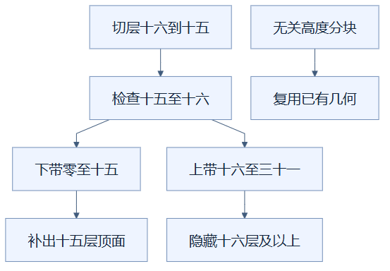

# 06：切层时只重建相关高度的分块

切层只改变一段高度的可见性，因此只安排与这段高度相交的分块重建，可以减少无关工作。（状态：已采用。）

## 先用百叶窗理解

一排百叶窗已经遮到某个高度，往下拉三格，主要改变的是这三格附近的开合状态，没有必要把远处所有窗片拆下来重装。切层高度相当于窗帘边缘，分块相当于一组窗片，几何重建相当于重新整理这组的可见表面。

比喻只适用于找出受影响区域。建筑的表面还会互相遮挡，所以边界以下的方块也可能需要露出顶面，不能机械地只处理“刚被隐藏”的方块。

## 实际选择范围

分块是边长为 16 格的数据与几何组织单元。程序先立即保存新的目标层，再计算旧、新高度之间的低值与高值；遍历分块编号，检查该块的高度区间是否与这个范围相交。同一层重复输入直接返回。

此前切层要广泛处理场景并反复建立位置表；现在复用完整位置索引，只把相关分块加入重建队列。每次实际重建会跳过高于新层的方块，邻居高于新层时也视为不可见，从而补出切面的内部表面。

下方并非忽略被切开的建筑内部，而是先缩小可能变化的分块范围。进入队列的分块仍按当前层重新判断可见面。

## 两个小例子

高度从 23 切到 20，变化范围是 20 到 23，仅与高度 16 到 31 的分块带相交。高度 0 到 15 的分块不受影响，可复用已有几何。

但从 16 切到 15 时，相交判断包含两端：高度 0 到 15 与 16 到 31 的分块带都会进入队列。上带需要隐藏高度 16，下带需要考虑高度 15 的顶面是否露出。程序使用“分块底部不高于范围上限，分块顶部不低于范围下限”的规则。

两条主分支说明边界切层为什么同时涉及上下两带。图中的“隐藏”改变的是显示状态，不是删除建筑数据；恢复高度时仍能重新显示。

## 适用与代价

这种方案适合频繁小幅调层、建筑跨越很多高度分块的情况。当前仍要遍历全部分块的编号，因此不是完全没有全局扫描，只是扫描分块元信息，而非重新处理所有方块。相关分块内仍可能有大量表面要重新创建。

从全部显示的无限高度切到有限层，范围可能覆盖许多上方分块，工作量会更大。透明部件或字牌真正变化时，还可能刷新全局透明批次；“局部选分块”不等于整个渲染流程的每一步都严格局部。后续构建签名也可能进一步跳过实际无变化的分块。

## 怎样验证

应核验真实目标层、切后内部暴露面、跨高度边界和恢复全景，再检查方块身份与点选。只看滑块标签不足以证明切层真的发生；此前输入读取顺序错误就让一轮“很快”的切层实际上没有执行。

最终十万格场景的新剖切完成仍约两百毫秒、恢复约四到五百毫秒，说明响应流畅与全部几何完成是两件事。这些时间属于整体实现及记录的本机条件，不能作为本项独立收益，也不表示通过隐藏数据或降低模型细节取得结果。

实现见 [viewer.ts](../../frontend/src/viewer.ts) 的 `setLayer`、`rebuild`；实际完成时间与正确性检查见 [优化记录](../RENDERING_OPTIMIZATION_LOG.md)。

## 读懂自检

**问：从高度 16 切到 15，为什么高度 0 到 15 的分块也要检查？**

答：它的顶部可能原来被高度 16 的方块遮住，现在应显示；只隐藏上方会漏掉新露出的切面。

[返回总目录](README.md)

<!-- diagram-sources -->

图示源文件：[图1](../../figures/rendering-guide/06-local-layer-cut-01.md) · [图2](../../figures/rendering-guide/06-local-layer-cut-02.md)。
