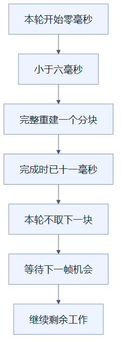

# 07：把几何重建分散到多帧

把大量分块重建拆成多轮工作，中途把执行机会交还浏览器，可以减轻一次长时间占住页面的问题。（状态：已采用，6 毫秒是调度预算而非硬性上限。）

## 先用整理书架理解

管理员要整理一百个书架，同时还要接待读者。如果从开馆开始连续整理到结束，读者会一直等；每整理几架就回服务台一次，全部整理未必更快，但接待更及时。

管理员对应浏览器主线程，书架对应分块，接待读者对应处理输入和绘制画面。主线程是页面主要逻辑共用的执行通道。这个比喻不代表另外派了管理员：当前仍由同一线程轮流做事，没有把几何重建放到后台工作线程。

## 当前怎样安排

待建分块放进一个去重集合，同一时刻只有一轮构建循环。循环开始先等待浏览器下一次动画帧机会，让连续输入有时间汇合；随后等待当前纹理准备完成。每轮记录开始时间，只要还有任务、已用时间小于 6 毫秒，就取一个分块完整重建。

超过预算后请求绘制；仍有任务就等下一轮动画帧机会，再继续。这里的动画帧回调，即 `requestAnimationFrame`，是浏览器安排下一帧相关工作的接口，不是“确认上一帧已全部由显卡完成”。

上方的问题是所有任务连续占用同一条执行通道。下方的循环通过主动让出执行机会减少连续阻塞，并不表示任务总量消失了。

## 为什么 6 毫秒不是保证

预算在开始下一个分块前检查，不会把正在重建的分块从中间切断。假设第一个分块单独需要 11 毫秒：开始时计时为零，可以进入；完成时已到 11 毫秒，才停止继续取下一个任务。

沿主线看，检查发生在整块工作之前，十一毫秒的任务仍会完整执行。预算控制的是是否继续接下一块，不能保证每个任务都小于六毫秒。

透明部件最终汇总仍是同步操作，没有在此拆成小块；纹理上传、导入解析等其他工作也不都由这个循环约束。隐藏标签页还可能降低动画帧回调频率。因此不能据此承诺固定帧率、首次导入永不卡顿或后台标签也同速完成。

## 适用、代价与验证边界

它适合可按分块拆开的较大重建。代价是最终完成可能需要更多轮等待，并出现一段构建中的状态；当前为避免错选，构建期间暂停方块点选。若单个分块特别重，下一步需要继续细分工作，单改预算数值不一定能解决。

`whenReady()` 返回构建完成的等待对象，让调用方知道几何准备好了；随后请求绘制仍要执行。等待对象结束不等于显卡已把最终像素呈现到屏幕，截图或计时还需要给绘制机会。

验证应同时记录逐帧间隔、主线程长任务和最终完成耗时。最终十万格组合实现的稳定阶段较流畅，但首次导入仍记录过 54 毫秒任务，完整显示仍需约三秒。该结果不能单独归因于时间切片，也不能把总耗时与页面阻塞时长混为一谈。

实现见 [viewer.ts](../../frontend/src/viewer.ts) 的 `scheduleBuild`、`runBuilds` 和 `whenReady`；测量条件见 [优化记录](../RENDERING_OPTIMIZATION_LOG.md)。

## 读懂自检

**问：一个分块耗时 11 毫秒，是否说明 6 毫秒预算机制没有运行？**

答：不一定。预算只在开始下一块前检查，单块不能中途暂停，因此这轮会超过预算后再让出执行机会。

[返回总目录](README.md)

<!-- diagram-sources -->

图示源文件：[图1](../../figures/rendering-guide/07-frame-budget-01.md) · [图2](../../figures/rendering-guide/07-frame-budget-02.md)。
