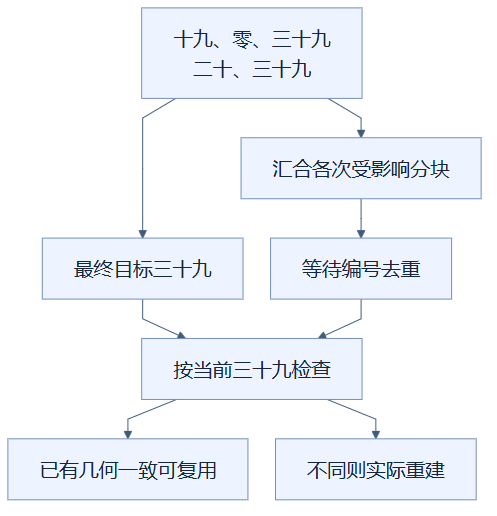

# 08：连续切层时使用最新目标

用户快速输入多个切层高度时，让尚未执行的分块工作读取最新高度，可以避免逐个重放已经过时的目标。（状态：已采用，和时间切片及构建复用协同工作。）

## 先用点单修改理解

你向服务员说“半糖”，接着改成“无糖”，最后又改成“正常糖”。如果饮料尚未制作，合理做法是按最后一次要求制作，而不是依次做好三杯再倒掉前两杯。

订单要求对应目标层，待做饮料对应待重建分块，制作开始对应同步重建函数执行。比喻的边界也很关键：已经做好的一杯不能假装没做过；代码不能在一个同步函数执行到一半时随意撤回全部指令。

## 队列里保存什么

每次切层先写入当前目标高度，再把受影响的分块编号加入去重集合。去重集合，即 `Set`，保证同一个编号在等待队列中只出现一次。队列不保存“按旧高度 19 重建”这种独立任务，只保存“这个分块需要检查”。

构建循环实际取出分块时，读取的是此刻的目标层。循环开头先等待一次动画帧机会，因而同一轮工作开始前的多次输入可以汇合。已经有循环运行时，不会再同时启动第二个循环。

上方的重复来源于每次输入都承担完整工作。下方把目标值与待处理编号分开保存，旧目标不会作为必须播放完的历史记录留在队列里。

## 一个小例子

假设当前高度是 39，重建开始前依次输入 `19 → 0 → 39 → 20 → 39`。每次都会更新目标并收集相关分块，最后目标是 39。轮到某个分块时，它按 39 构建，而不是先按 19、再按 0、再重复恢复。

“汇合各次受影响分块”这一支负责收集工作范围，“最终目标三十九”这一支负责保存最新目标，两者在执行时会合。范围可能仍包含中间输入涉及的很多分块；能否直接复用，还取决于下一篇的构建签名判断。

## “取消旧任务”的真实含义

这里的取消指不再按旧目标创建等待中的结果，并不是终止一个运行中的工作线程。若新输入到达前某块已经建好了，它的成本已经发生；新目标还可以把该编号再次排队，确保最终状态正确。

同样，快速输入不保证队列立刻变空。多次高度变化会形成受影响分块的并集，仍要检查这些编号，只是不用重放每个中间高度。整个场景或资源更换时会清空旧等待编号，并等待新的纹理；这不是一个额外的并行取消系统。

## 适用、代价与验证边界

这种机制适合滑块拖动、连续步进等最终目标更重要的交互。它牺牲了“每个过渡层都完成显示”的要求；若做必须逐层展示的教学播放，播放节奏与等待完成需要另外设计。输入值已更新，也不表示最终几何已完成。

应发送确定的多次输入，检查最后实际层、最终几何覆盖和恢复结果，等待构建与绘制后再截图；不能仅凭输入控件显示最后数字判定成功。最终十万格的五次急切完成约四十多毫秒，是最新目标、时间切片、签名复用等组合效果，没有本项独立帧率结论。输入分散到更长时间、工作已开始的情况也可能更慢。

实现见 [viewer.ts](../../frontend/src/viewer.ts) 的 `setLayer`、`scheduleBuild` 与 `runBuilds`；急切测试条件见 [优化记录](../RENDERING_OPTIMIZATION_LOG.md)。

## 读懂自检

**问：最后高度回到 39，是否意味着此前所有工作都能撤销且完全零成本？**

答：不能。尚未执行的工作使用最新目标，已执行的成本保留；队列仍需检查，只有符合复用条件的几何才能跳过重建。

[返回总目录](README.md)

<!-- diagram-sources -->

图示源文件：[图1](../../figures/rendering-guide/08-latest-input-01.md) · [图2](../../figures/rendering-guide/08-latest-input-02.md)。
