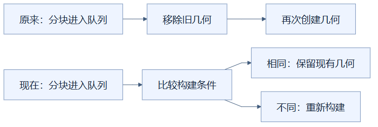
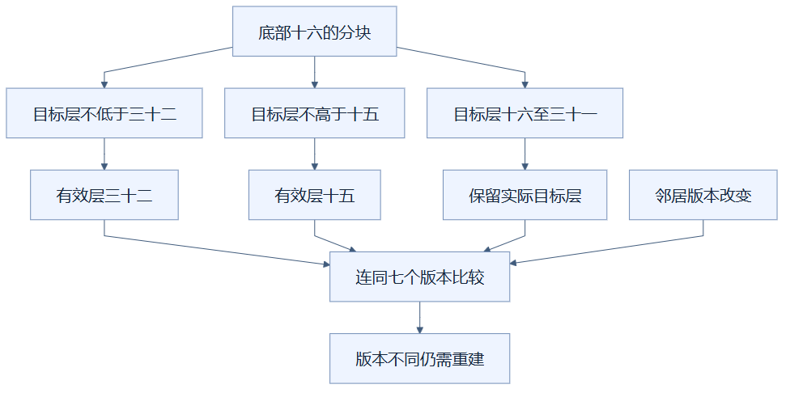

# 09：变化条件相同时复用已有几何

重建前先比较方块版本、邻居版本和有效切层，相同就保留已有几何，可以跳过队列中的无效重复工作。（状态：已采用。）

## 先用菜单校对理解

餐厅准备重印菜单前，先核对菜品版本、价格版本和排版版本；这些条件都没变，就继续使用原菜单。不能只看菜名没变，因为价格已经调整也必须重印。

菜单对应分块几何，版本清单对应构建签名，重印对应销毁并重新创建网格。签名是描述当前几何依赖条件的一串值，不是把整份内容做成密码学散列；程序相信更新流程会正确推进版本。

## 为什么要包含邻居

每个分块收到数据变化时，版本计数增加。当前签名包含本分块和六个面相邻分块的版本，再加有效切层。邻居能遮住本块表面，因此本块方块没改，邻居变化仍可能要求重建。

此前分块只要进入队列，就可能移除旧对象并重新构造。现在 `rebuild` 开始先算签名，与这个分块已构建时保存的签名比较；相同直接返回，不同才替换几何。清空场景或更换资源时，签名与版本一起重置。

下方把条件比较放在移除旧几何之前，避免先拆掉再发现其实没变化。它省掉的是创建、复制与释放工作，队列检查本身仍会执行。

## “有效切层”如何计算

对于底部高度为 16 的分块，它占用高度 16 到 31。所有不高于 15 的切层都让它完全隐藏，可归为有效层 15；16 到 31 的层各有不同结果；不低于 32 的层归为有效层 32。

为什么上限是 32 而非 31？高度 32 的邻居可能遮住本块高度 31 的顶面。切到 31 时该邻居隐藏，顶面需要露出；切到 32 时可能再次被遮住。所以有效层必须多保留上方一层的区别。

三条分支把无限多的高度压缩为与该分块表面有关的条件。底部与邻居版本不变时，高度 40 和 50 都归到 32，可复用；但邻居版本一变，即使高度相同也不能直接跳过。

## 适用、代价与验证边界

它适合连续输入最终回到原状态，或者操作安排了某些实际无变化分块的场景。签名只记录当前已构建结果，没有缓存每个历史高度的完整网格。如果已经按新层重建，再回到旧层，仍可能要重建；不能理解成任意高度切换都有历史缓存。

保存版本与签名需要少量额外数据；依赖维护不完整会错误复用旧表面。因此验证要覆盖邻居增删、上下边界变化、资源替换，以及快速输入回到初始层，检查实际几何而非只看等待时间。

历史迭代曾观察到五次急切从约 740–813 毫秒降至 42–49 毫秒，促成保留这类复用机制；这些是当时组合版本的测试，并非控制其他因素后的独立因果测量。最终数字另有对应包与条件，不能把历史快照冒充当前版本，也不能单凭签名相同证明严格像素一致。

实现见 [viewer.ts](../../frontend/src/viewer.ts) 的 `chunkGenerations`、`builtKeys` 与 `rebuild`；历史与最终测量见 [优化记录](../RENDERING_OPTIMIZATION_LOG.md)。

## 读懂自检

**问：本分块的方块完全没改，签名为什么还可能变化？**

答：邻居版本或有效切层变化也会影响哪些表面可见；签名必须包含这些依赖，才能安全复用。

[返回总目录](README.md)

<!-- diagram-sources -->

图示源文件：[图1](../../figures/rendering-guide/09-mesh-version-reuse-01.md) · [图2](../../figures/rendering-guide/09-mesh-version-reuse-02.md)。
