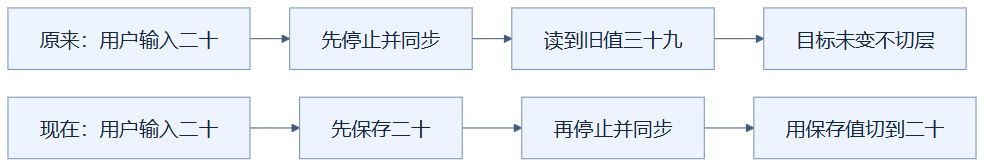
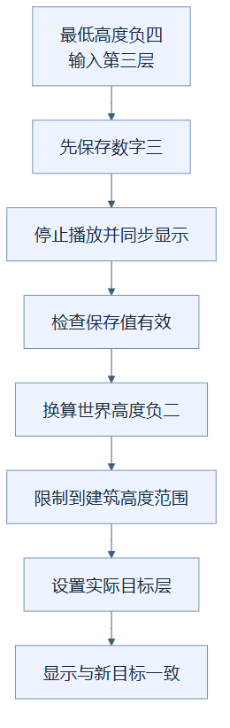

# 10：先保存输入值，再同步控件

切层事件先保存用户刚输入的值，再停止播放和同步控件，可以避免新值被旧状态覆盖。（状态：已采用的正确性修复，本身不是帧率优化。）

## 先用柜台登记理解

顾客把地址改成新地址，柜员却先按档案里的旧地址重填表格，再读取表格，最后读到的当然还是旧地址。合理顺序是先记下顾客的新地址，再整理档案显示，最后用新地址提交。

顾客填写的表格对应输入控件，旧档案对应当前切层状态，重填对应同步函数。比喻只说明读取与回写的先后；项目还会暂停播放、校验输入并限制可选高度。

## 新值是怎样丢失的

滑块输入事件发生时，控件里已经是用户的新高度。停止播放函数 `stop()` 不仅清掉播放计时器，还会调用同步函数 `sync()`，将滑块与数字框重新填成当前渲染目标层。

原来的顺序是先停止，再读取滑块。如果当前高度 39、用户拉到 20，停止时同步又把滑块写回 39；随后读取到 39，切层函数认为目标没变，直接返回。页面很快完成，却没有执行用户要求的切层。

两条路径都有停止和同步，差别只是读取发生在什么时候。下方先保存新值，即使控件暂时被回写，也不会丢失本次输入的目标。

## 当前怎样处理两种输入

滑块处理器先把控件值转换为数字保存在局部变量，再调用停止，最后用保存的数字切层。数字框也先读取数值，再停止；只有数值有限时才跳转，否则重新同步显示。空输入得到无效数值，不能拿它当作正常高度。

数字框显示“第几层”，滑块保存世界高度，两者不是同一数字。若建筑最低高度是 -4，输入第 3 层对应 `-4 + 3 - 1 = -2`。跳转函数将目标取整，并限制在有方块的最低与最高高度之间。

主线从用户序号走到世界高度，说明数字框需要经过坐标换算。同步发生后，判断和换算使用的仍是保存值，最后再把显示更新到新目标。

全部显示模式使用无限高度作为状态，控件显示建筑最高层；两者在数字上可能看起来接近，语义却不同。没有建筑数据或界面处于暂停交互状态时，跳转仍会被拒绝，不能仅从事件已触发推断操作成功。

## 为什么它影响性能结论

这是输入正确性问题，修复的目的是真正执行切层。旧代码产生的空操作当然很快，但它不能代表渲染性能。记录中第二轮切层与急切时间已明确作废；修正后观察到真实重建约 647 毫秒的阻塞，才进一步推动时间切片等优化。

合理验证应检查实际层数、屋顶是否消失、切面是否露出以及恢复结果，再记录耗时。标签变化、没有报错或等待很短，都不足以证明工作完成。正确性检查让性能数字有意义，而不是额外追求一个更漂亮的时间。

这项修复只增加一次局部数值保存，适合所有“控制动作会同步回写输入”的事件处理。它没有独立帧率提升结论；快速切层的最终结果来自真实执行后的多项优化。

实现见 [layerPlayer.ts](../../frontend/src/layerPlayer.ts) 的输入处理器、`stop`、`seek` 与 `sync`；作废结果和重新测量见 [优化记录](../RENDERING_OPTIMIZATION_LOG.md)。

## 读懂自检

**问：一次切层只用了很短时间，是否就能证明渲染优化成功？**

答：不能。先确认实际目标层和几何确实改变，排除空操作，再讨论耗时与帧率。

[返回总目录](README.md)

<!-- diagram-sources -->

图示源文件：[图1](../../figures/rendering-guide/10-layer-input-fix-01.md) · [图2](../../figures/rendering-guide/10-layer-input-fix-02.md)。
