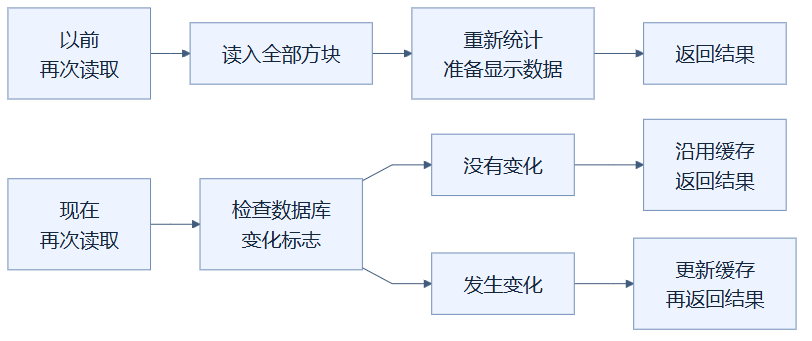
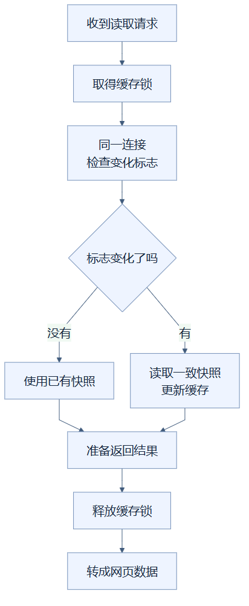

# 11 · 场景没变，就沿用已经整理好的结果

**已采用。** 你按一下“重新读取”，建筑没有变化，后台就不必重新拆开十万个方块再整理一遍。它先确认数据库是否变化；没有变化时，复用上次准备好的场景摘要和显示数据。

这里的“后台”是 Python 服务，负责读取项目和准备发给浏览器的数据。**缓存**就是把计算结果暂时留在内存里，方便下次使用；它不是另一个保存文件，数据库仍是项目的正式记录。

## 像图书管理员留下一份已经核对的清单

想象管理员刚清点过十万本书。你再次询问馆藏数量，若这期间没人调整书架，直接回答上次的统计就够了。若有人还书、换书或改分类，管理员必须重新核对相关内容。

对应到项目，书是方块，馆藏清单是缓存，正式借阅账本是数据库。这个比喻的边界是：程序不会靠“看起来没人操作”判断，而是让数据库报告是否发生过提交；这个报告也不会直接告诉它哪一格变了。

这张图怎样读：从“以前再次读取”出发，每次都要经过“读入全部方块”和“重新统计”。从“现在再次读取”出发，会先检查变化标志；只有发生变化才走更新路线，没有变化就直接沿用上次结果。

## 怎样确认“没有变化”

项目使用 **SQLite**，一种把数据库放在本地文件中的工具。缓存为每个项目保留同一个只读连接，查询 `PRAGMA data_version`。可以把它理解为“这条连接看到的数据库变化标志”。别的连接提交修改后，这个标志会变化。

“同一个连接”很关键：标志的数值只适合与这条连接上次读到的值比较，不能每次换一个连接，再把两个数字随意对照。这里的小写 `data_version` 也不是蓝图里的 Minecraft `DataVersion`；后者表示游戏数据格式版本，例如 3465，与数据库有没有被编辑是两件事。

例如，缓存已记录项目修订 8。再次读取时标志未变，就使用修订 8 的结果。外部工具即使修改了数据库却没增加项目修订，数据库变化标志仍会触发重新读取。因此它不是只相信“修订号没变”。

读取时使用 **事务**，即把相关读取放在同一份数据库快照中，避免摘要来自修改前、方块来自修改后的混搭。若编辑恰好与读取同时发生，本次可以返回一致的旧快照，下一次读取会发现变化。

这张图怎样读：菱形判断的是同一数据库连接观察到的变化标志，两个分支都要得到一份完整、前后一致的结果。下方“释放缓存锁”之后才转成网页数据，表示锁保护的是缓存准备过程；没有变化的分支能更快让后面的请求继续工作。

## 快在哪里，又有哪些边界

100,000 格混合城镇的独立测量中，无变化的“载入＋准备显示数据”中位数从 **992.37 ms 降至约 0.26 ms**；摘要读取从 347.42 ms 降至约 0.13 ms。中位数是把多次耗时排序后居中的值。这些是后台函数的热缓存结果，不包括网络、网页处理或第一次打开项目。

缓存有总共 500,000 个已存储格、最多 4 个项目和估算字节容量的限制，不会永久保留所有建筑。旧条目按最近使用情况淘汰。百万格建筑超过容量，会在请求结束时被淘汰，后续读取仍需重新准备，无法享受上述热缓存速度。

**RLock** 是当前保护缓存的一把可重复进入的锁，让多个请求不会同时改坏缓存；代价是大项目的冷读取可能让其他项目等待。返回的嵌套数据还共享缓存引用，直接调用 Python 接口的代码应只读使用。网页接口只是把数据转成 JSON，不会修改这些引用。

实现见 [缓存](../../src/design_workbench/adapters/rendering/cache.py)和 [数据库读取](../../src/design_workbench/adapters/storage/sqlite.py)；测量与限制见 [优化实验记录](../RENDERING_OPTIMIZATION_LOG.md)。

## 读懂自检

数据库没变，是否还要逐格解压？**答案：不需要，可以复用缓存。**

0.26 ms 是否表示十万格第一次打开只需这么久？**答案：不是，它只测已经准备好缓存后的后台读取函数。**

[总目录](README.md)

<!-- diagram-sources -->

图示源文件：[图1](../../figures/rendering-guide/11-backend-read-cache-01.md) · [图2](../../figures/rendering-guide/11-backend-read-cache-02.md)。
