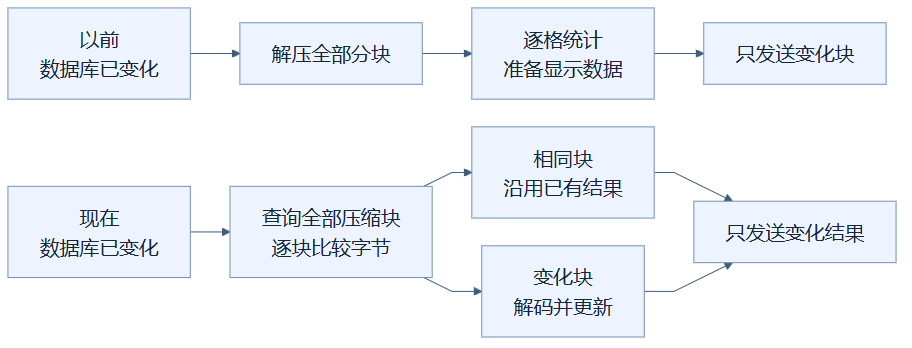
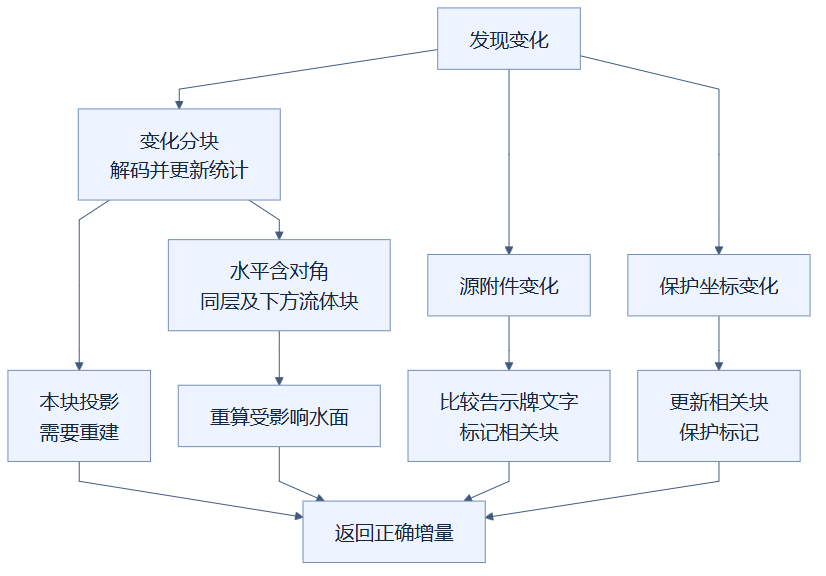

# 12 · 数据库变了，只拆开真正变化的分块

**已采用。** 改一格以后，后台仍会核对全部压缩分块，但只把内容变化的分块解压成方块，再更新相关显示数据。邻居受影响的水面、告示牌文字和保护标记，也一起正确更新。

这是上一章的下一步：上一章解决“完全没变”；这一章解决“变了一点”。它没有把检查全部分块省掉，而是省掉大量逐格解压、统计和显示数据重建。

## 像核对货箱，却只打开被换过的箱子

项目把空间分成 **16×16×16 格的分块**，每块最多容纳 4,096 个坐标。数据库把分块内容压缩保存。可以想象仓库有很多封好的货箱：核对箱子外面的记录，比拆箱、取出每件货、重新登记省力。

这里的比喻需要修正一点：代码比较的是每箱保存的压缩字节，不是一个能识别变化的贴纸。**BLOB** 指数据库里的一段二进制数据，里面装着压缩后的方块、分组等内容。数据库变化后，程序查询所有分块的 BLOB，与缓存逐块比较；相同的沿用，不同的才**解码**，也就是解压并还原成能查询的方块对象。

这张图怎样读：旧路线和新路线最后都只发送变化内容，区别发生在发送之前。新路线先比较全部压缩块，把相同块分到“沿用”分支、变化块分到“解码”分支，因此省下的是拆开大量未变分块的工作。

以前“只发送变化块”已经减少了传输，却仍先做全场景的后台计算。现在把后台准备过程也变成局部工作。**投影**在这里指从正式场景派生的显示数据，包括方块坐标、模型编号和保护标记，不是修改正式方块。

## 为什么还必须更新邻居

假设 A、B、C 三块已经缓存。你只替换 B 中的一格石头，A 和 C 的压缩数据不变，它们的方块对象与统计继续使用。B 重新解码，更新自己的统计与投影。摘要会合并各块的统计，因此可以得到全建筑的正确方块数；不是再次数每个方块。

但水面取决于周围格子。水格位于 `(15,15,15)`，旁边的水位或 `(16,16,16)` 的水发生变化时，原水格的表面高度也可能变化。虽然原水格所在分块的 BLOB 没变，它的显示模型仍要重建。

代码因此检查变化分块周围的水平邻块，包括对角方向，以及同一高度和下方的流体分块。之所以是下方，是因为水格模型还会采样上方一层：上面改了，下面的水面可能受影响。邻块通常只重建投影，已有方块对象仍可沿用。

这张图怎样读：左侧分块路线表示改方块既要更新本块，也可能影响旁边和下方的水面；右侧两条路线处理文字附件和保护坐标。三种变化来源可以分别出现，也可以同时出现，最后把所有受影响的显示结果合在一起返回。

告示牌文字来自保留的蓝图附件，不只来自方块状态。附件变化时比较新旧文字，更新涉及的分块；保护坐标变化时也更新相关投影。资源包更换则会重建所需模型，并把资源哈希加入分块传输版本，确保浏览器不会继续使用旧资源。

## 测量该怎样理解

100,000 格场景的独立后台实验中，修改 100 格和 1,000 格后的增量准备分别约 **30.87、31.91 ms**，各只解码并重建 6 块。这组数据说明成本与触及的分块有关：一百格散落很多块，可能比一千格集中在几块更费力。

它不是网页点击到完成的总时间，也不是所有模型都一样快。首次建立缓存仍要全量解码；数据库变化后仍要读取、比较所有压缩块。缓存总格数限制和共享锁的等待代价也仍存在，详见上一章。

实现见 [分块缓存](../../src/design_workbench/adapters/rendering/cache.py)、[水面模型](../../src/design_workbench/adapters/rendering/fluids.py)和 [分块投影](../../src/design_workbench/adapters/rendering/packets.py)；证据见 [优化实验记录](../RENDERING_OPTIMIZATION_LOG.md)。

## 读懂自检

改一格，数据库是否只查询一个分块？**答案：不是，仍查询全部压缩块，只解码真正变化的块。**

本块数据没变，水面就一定不用重建吗？**答案：不一定，上方或水平邻居变化也可能影响水面。**

[总目录](README.md)

<!-- diagram-sources -->

图示源文件：[图1](../../figures/rendering-guide/12-chunk-decode-cache-01.md) · [图2](../../figures/rendering-guide/12-chunk-decode-cache-02.md)。
