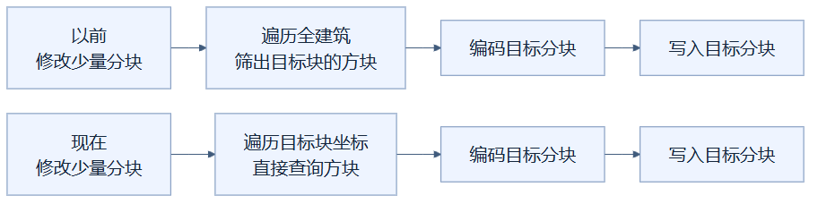
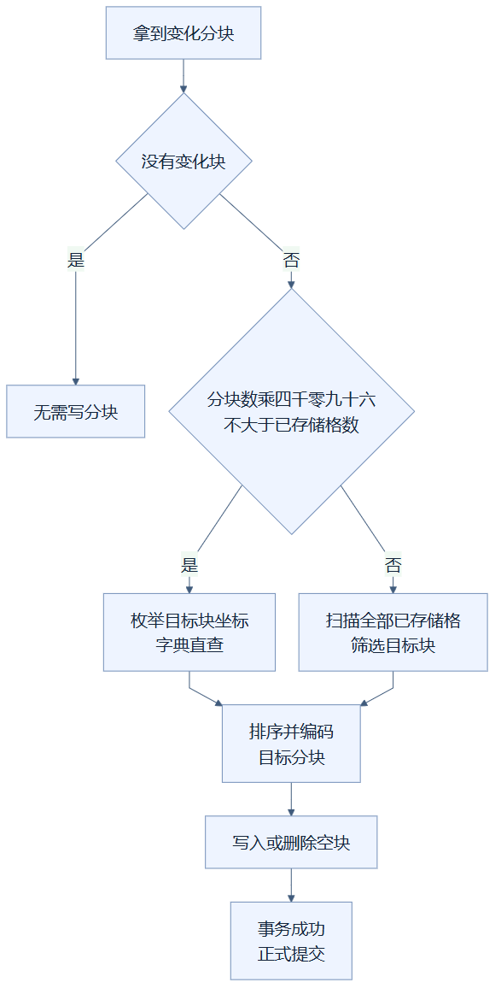

# 13 · 保存局部修改时，直接寻找附近坐标

**已采用。** 只改少量分块时，保存程序直接查询这些分块内的坐标，避免为了找出附近方块而遍历整个建筑。修改范围很大时，仍使用全场景扫描，选择更合适的收集方式。

这项优化发生在保存阶段。它与显示缓存不同：缓存可以丢弃重算，数据库里的项目内容必须完整、正确地写入。

## 像修一层楼，不用逐户问全城

假设维修队只要清点一栋楼的一层住户。以前做法是翻全城名单，逐人判断是否住在这一层；现在直接查询这一层的门牌。若要清点全城，重新按楼层挨个查空门牌就不划算，翻完整名单反而合适。

代码里的“名单”是一个 **字典**，也就是按坐标快速查找方块的表。“这一层”对应一个 16×16×16 的分块，“门牌”对应分块内的 4,096 个坐标。比喻的边界是：查询范围中有空格，程序也会查一下，但空格不存在方块就跳过，不会因此在项目里新增空气块。

这张图怎样读：两条路线都会编码和写入目标分块，区别是怎样找到这些分块里的方块。旧路线先检查全建筑，新路线在小范围修改时直接查附近坐标，所以节省的发生在收集阶段。

注意，原版也只编码、写入触及的分块。它浪费的主要是**找这些方块时扫描了全建筑**，不是每次都重写整个数据库。优化改变的是收集路径，保存范围保持一致。

## 程序怎样选择收集路径

若没有分块需要写，直接返回。否则估算“目标分块数 × 4,096”；这个数不大于场景的已存储格数时，采用坐标直查。超过时采用原来的扫描与筛选。这叫**回退路径**：遇到不适合局部策略的情况，沿用已经正确工作的通用做法。

例如建筑有 100,000 个已存储格，只改一块：直接查询最多 4,096 个坐标，比逐格检查十万个方块更省。若要改 100 块，逐块直查会经过 409,600 个坐标，此时扫描十万个已存储格更合适。

两条路径收集完成后，都会按坐标排序，生成相同的方块状态表和格子条目，再压缩保存。负坐标也遵守分块边界：例如 X=-1 属于 X 从 -16 到 -1 的分块，不会误写到正坐标块。分组、来源区域以及显式保存的特殊空气状态也不会被丢掉。

这张图怎样读：第一个菱形先判断有没有分块要写，没有就结束分块写入步骤；整个请求是否还需更新元数据，要由外层事务处理。第二个菱形比较两种收集方式的估算工作量，选出的路线最终汇入同一套编码、写入和提交保障。

## 快速收集不等于可以跳过保存保障

提交使用数据库**事务**，将分块、项目元数据和历史记录作为一组改动完成。它仍检查**期望修订**，即这次编辑依据的项目版本：如果别人已经修改项目，就报告冲突，而不是把旧计划强行覆盖。没有绕过事务，也没有降低 SQLite 的持久写入保障。

105,102 格、188 分块场景的独立实验，只测内存数据库中的分块收集、编码和写入。修改 1 块的中位数从 **34.99 ms 降至 0.23 ms**，5 块从 40.17 ms 降至 5.79 ms；新旧压缩行逐字节相同。

全量 188 块的观测中位数却是 **184.79→209.69 ms**。两者走同类扫描路径，测量也有波动；这个不利结果仍保留，不能声称本优化让全量写入更快。上述时间还不包括从磁盘载入场景、编辑规划和耐久提交，更不代表网页点击到完成的时间。

实现见 [分块写入与事务](../../src/design_workbench/adapters/storage/sqlite.py)；实验条件与原始结果见 [优化实验记录](../RENDERING_OPTIMIZATION_LOG.md)。

## 读懂自检

以前保存一格会重写全部分块吗？**答案：不会，原版只写目标分块，但收集时扫描了全建筑。**

坐标直查为什么不永远更快？**答案：范围很大或很空时，它会查询大量空坐标，因此需要扫描回退路径。**

[总目录](README.md)

<!-- diagram-sources -->

图示源文件：[图1](../../figures/rendering-guide/13-local-chunk-write-01.md) · [图2](../../figures/rendering-guide/13-local-chunk-write-02.md)。
