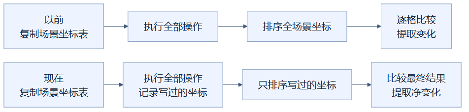
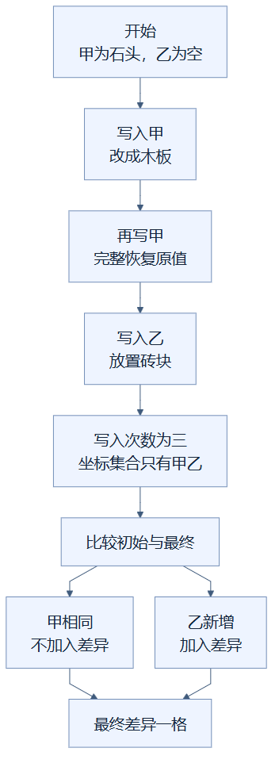

# 14 · 记住碰过哪些坐标，只比较最后的净变化

**已采用。** 一次编辑只碰过几个坐标，就只比较这些坐标的前后结果，避免把十万个没动过的方块全部排序、比较。反复修改同一格，最终会合并为这格真正留下的变化。

这里的**净变化**是“一次请求开始前，与全部操作执行完之后的差别”。它不是鼠标点击次数，也不是过程中出现过的每一种临时方块。

## 像做菜时记住用过的调料罐

厨房有几百个调料罐。做一道菜只碰过盐、糖和胡椒，收工时只核对这三罐就够了，不必逐一检查所有罐子。若某罐被拿出来又原样放回，操作发生过，却没有留下库存变化。

调料罐对应方块坐标，核对库存对应比较方块状态、分组和来源区域。比喻有一个边界：程序仍先复制场景的坐标表，让试算不会直接改坏正式场景。复制的是“坐标对应哪个方块”的表，不是逐个重造所有方块对象，这称为**浅复制**；本优化没有省掉它。省掉的是结尾那次全场景排序和比较。

这张图怎样读：两条路线开始时都复制场景坐标表，正式场景都不会被试算直接修改。变化在操作结束后：旧路线检查全场景，新路线只检查写过的坐标，最终仍得到同样的净变化清单。

## 谁来保证没有漏记

各种编辑工具最终都通过一个叫 `put()` 的写入入口改变工作副本。入口负责检查坐标边界、规范化方块状态、保护内容和编辑预算，并把写过的坐标放进 **set**，即不允许重复元素的集合。

某一坐标写了三次，集合里仍只有一个坐标。结束时，只对集合里的坐标取“原始方块”和“最终方块”，不相同的才加入 **delta**，也就是正式保存和撤销需要的差异清单。未经过写入入口的坐标保持不变，因此不用再比较。

例如开始时 A 是石头，B 为空。一次请求先把 A 换成木板，再把 A 恢复成原来的石头；随后在 B 放砖块。若 A 的分组和来源区域也恢复原样，最后只留下 B 的新增；若分组被改变，A 仍算变化，不能只看材料名字。

这张图怎样读：甲先变成木板又完整恢复成石头，所以“操作过”不等于“最终有变化”。乙从空格变成砖块，最后只有乙进入差异清单；三次写入仍计入工作量预算，不会因为差异只有一格就算成一次操作。

重复写入仍计入 `touched`，即尝试写入的次数。预算按实际工作量检查，不能借助“最后没有净变化”绕过大量操作的限制。变换工具移动方块时，清除来源和写入目标也都通过这个入口记录，不会只记录目的地而漏掉删除。

## 规划完成之后，还没有正式保存

**编辑规划**是在工作副本上试算，得到完整的新方块表、净变化和写入次数。预演可以展示这份计划而不写入数据库。正式编辑还要进入保存事务，核对期望修订，原子写入分块、元数据和历史。若其他请求已提交新修订，事务会拒绝过期计划。

因此，“只比较触点”不代表“只做这一步就保存成功”。它没有改变源场景隔离、保护规则、操作预算或事务边界。

105,102 格场景的 11 次独立函数测量中，编辑规划中位数分别为：1 格 **67.00→2.51 ms**，100 格 **67.59→3.33 ms**，1,000 格 **73.66→8.63 ms**。新旧完整方块表、净差异与写入次数一致。

这些数字只测 `Editor.plan`，不包含数据库载入、持久提交、网络或网页刷新。大量范围选择仍可能扫描场景，完整坐标表也仍要复制；不能把局部差异的收益解释为所有编辑都立即完成。

实现见 [编辑规划](../../src/design_workbench/domain/editing.py)、[应用层提交](../../src/design_workbench/application/scenes.py)和 [数据库事务](../../src/design_workbench/adapters/storage/sqlite.py)；证据见 [优化实验记录](../RENDERING_OPTIMIZATION_LOG.md)。

## 读懂自检

同一格改三次，必然保存三条变化吗？**答案：不必，只比较开始与结束的结果，相同则没有净变化。**

这项优化省掉了完整场景复制吗？**答案：没有，仍复制坐标表；省掉的是最终全场景排序和比较。**

[总目录](README.md)

<!-- diagram-sources -->

图示源文件：[图1](../../figures/rendering-guide/14-edit-net-delta-01.md) · [图2](../../figures/rendering-guide/14-edit-net-delta-02.md)。
