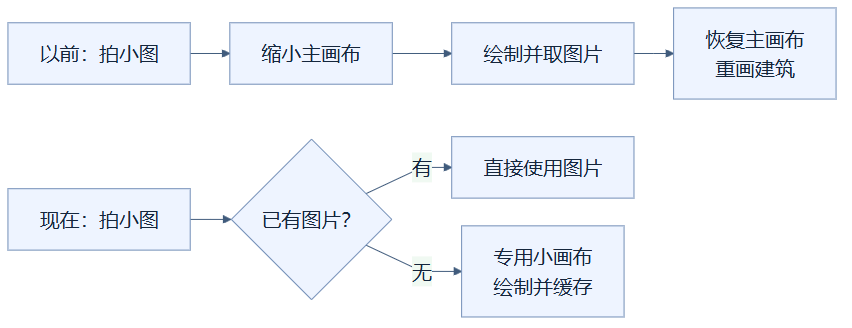
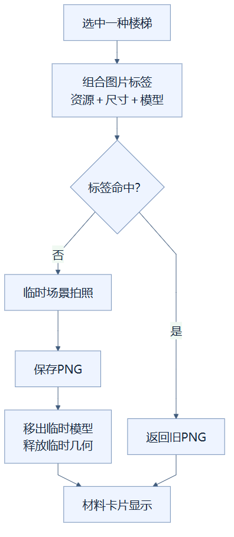

# 15｜独立缩略图：小照片有自己的摄影棚

**人话一句：材料栏拍方块小照片时，用另一张小画布，让建筑主画布继续做自己的事。**

**状态：已采用。** 当前 `Viewer.thumbnail()` 使用独立的 `thumbnailRenderer`，并缓存生成的图片。

## 先想象一家摄影馆

建筑主画布像正在拍全家福的大摄影棚：相机位置、画布大小、灯光和已经画出的内容都准备好了。材料栏里的石头、楼梯等小图标，只需要一张“证件照”。如果每拍一张证件照，都把大摄影棚缩小、换掉被摄对象，再恢复全家福，来回搬动就是额外工作。

这里的**渲染器**是负责把三维模型画成图片的工具。**画布**是它输出图片的地方。独立缩略图渲染器仍在同一个浏览器里，也仍然使用显卡；“独立”指它有自己的画布和绘制状态，不代表另开一台电脑或自动放到后台线程。

## 以前与现在的流程

原实现会临时改变主渲染器尺寸，把缩略图画到主画布，读取图片，再恢复原尺寸并请求重画建筑。恢复尺寸也要做工作，材料翻页时还可能连续重复许多次。现在把这一流程交给小图专用渲染器，主画布尺寸不再为拍小图来回改变。

从“以前：拍小图”开始的是原流程，经过缩小主画布，一路走到恢复尺寸、重画建筑，箭头表示操作先后。从“现在：拍小图”开始的是当前流程，到“已有图片？”分成两条路：有图直接取，无图才交给专用小画布拍照。

缩略图默认是72×72像素，专用渲染器的像素倍率固定为1。这个选择只针对材料栏小图，不会降低建筑主画布分辨率。小图使用临时场景、灯光和相机，把方块摆在同一角度，得到PNG图片后交给材料卡片显示。专用渲染器首次需要时才创建，之后继续复用。

## “同一张小图”怎么认出来

**缓存**就是把已经做好的结果放到架子上，下次直接取。架子标签同时写上资源包标识、图片尺寸和完整模型内容。模型内容包含影响外观的状态，因此朝东的楼梯与朝西的楼梯有不同标签；同一方块改用另一套贴图，也有不同标签。

从最上面的楼梯选择往下看，标签检查决定走“返回旧PNG”，还是走临时拍照、缓存和清理。两条路线最后都汇入“材料卡片显示”，箭头表示这一次取图的处理顺序，不表示又要重画主建筑。

例如你先翻到橡木楼梯，再看石头，最后返回同一个橡木楼梯状态。如果图片还在缓存中，就直接取PNG。改成另一种朝向，或者资源包更换，就需要生成相应新图。缓存最多保留256项，按插入先后移出最早项；经常查看某项不会自动把它移动到队尾，所以这里不是“最近最少使用”的LRU。

生成小图时临时登记的模型会被移出，临时几何也会从几何缓存删除并调用释放方法。留下的是可复用的小图渲染器和有数量限制的图片缓存，不是每次拍照都永久堆积一个新三维场景。

## 它解决了什么，测量又说明什么

这项改动直接减少主画布尺寸切换和重复拍照。它有第二个渲染器的成本，小图首次生成也仍需要绘制和读取PNG；独立画布不能让搜索、网络请求等其他工作消失。

最终CeI4包在本机RTX5060Ti、Chrome154的10万格连续GUI交互中，帧间隔P95为16.8ms，操作包含材料搜索、翻页和状态选择。这是整套优化后的结果，没有单独开关缩略图方案的对照，不能把全部帧率收益都算到这一项。综合操作中还存在一次50.1ms帧，完整证据见实验记录。

## 读完自检

1. 拍小图的画布倍率为1，会让建筑主画布也降清晰度吗？**不会，两者是独立画布。**
2. 朝向不同的楼梯能直接共用一张小图吗？**完整模型不同，标签不同，应分别缓存。**
3. 图片缓存命中意味着又绘制了一次三维模型吗？**不用，直接返回之前生成的PNG。**

实现可查：[Viewer.thumbnail](../../frontend/src/viewer.ts)。测量可查：[优化实验记录](../RENDERING_OPTIMIZATION_LOG.md)的实验04与最终交互。继续阅读：[16｜有界缓存](16-bounded-caches.md)，或返回[总目录](README.md)。

<!-- diagram-sources -->

图示源文件：[图1](../../figures/rendering-guide/15-independent-thumbnails-01.md) · [图2](../../figures/rendering-guide/15-independent-thumbnails-02.md)。
