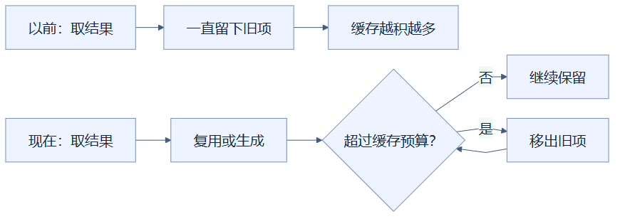
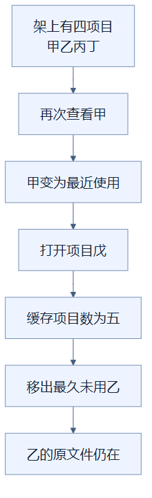

# 16｜有界缓存：架子要有容量，也要会腾位置

**人话一句：已经做过的结果可以留着复用，但缓存要限制规模，满了就移出旧项。**

**状态：已采用。** 前端几何和缩略图缓存有项数限制；后端渲染投影缓存同时限制项目数、方块数和一部分字节估算。

## 从“把工具留着”理解缓存

做模型时，每次都重新制作同一把尺子很浪费，所以可以把尺子放在工具架上。不过，如果所有用过的工具永远留下，架子会越来越满。缓存解决重复计算，有界缓存再补上一条规则：架子达到预算时要腾位置。

**缓存项**是一份可以复用的结果，例如某个模型与可见面组合的几何，或者某种状态的PNG小图。**淘汰**是把结果从缓存移出，不是删除用户蓝图。下次再次需要它，可以从源数据重新生成，代价是这次请求没有命中缓存。

从“以前：取结果”一路走到“缓存越积越多”，说明旧项没有容量检查时会持续留下。从“现在：取结果”开始的是当前流程，超预算就移出旧项，再沿回箭头重新检查，直到进入“继续保留”分支；箭头表示检查和腾位置的先后。

## 三种架子，规则并不相同

| 缓存 | 当前预算 | 满了如何选旧项 |
| --- | --- | --- |
| 前端几何模板 | 4096项 | FIFO：最早插入的先移出 |
| 前端PNG缩略图 | 256项 | FIFO：最早插入的先移出 |
| 后端项目渲染投影 | 4项目、合计50万格、128,000,000字节估算 | LRU：最久没访问的项目先移出 |

**FIFO**像排队，谁先入队谁先离开。几何或图片被再次读取时，当前实现不会调整它的插入顺序。**LRU**像常用文件夹，刚访问过的移到最近使用的一端，最久没碰的先腾走。不能把这些缓存统称“都是LRU”。

后端的三个预算是一起检查的，任意一个超出就继续淘汰项目，直到满足限制。它们是所有缓存项目的合计预算，不是每个项目都可以各占50万格。项目投影保存的是为了显示而整理的结果，SQLite项目文件仍是正式数据来源。

## 一个LRU小例子

假设架子已经放了甲、乙、丙、丁四个项目，你又打开甲，甲就变成最近使用。随后打开戊，项目数变为五，最久未访问的乙先被移出。再次打开乙要重新整理投影，但乙的建筑不会丢失。

从“四项目”往下逐步看，先访问甲改变最近使用次序，再加入戊，超过项目数预算后移出乙。最后一格强调只移出了缓存投影，箭头是这个LRU例子的事件顺序，不表示乙的原文件也被移动或删除。

## “128MB”究竟限制了什么

这个数统计了压缩分块、保留源内容和渲染数据的一部分字节估算。渲染数据使用序列化后的大小估算，Python容器、对象等额外开销并未全部按真实占用计算；浏览器中的建筑、GPU缓冲和正在返回的HTTP数据也不属于这个后端缓存账本。

还有一个时间边界：大请求可能先完成载入和计算，再在请求结束时检查预算。超过预算的项目可以不留在缓存里，但计算过程仍可能占用较多内存。因此这是一套缓存留存预算，不是“整个程序内存永远不超过128MB”的保证。

历史D18候选压力测试载入了完整115.6万格城堡，超过50万格合计预算，项目投影被淘汰，无法享受随后的小场景热缓存收益；两次保存刷新约14.9–15.6秒。这是本机压力边界，不能由小场景函数热缓存约0.2ms推断百万格也同样快。

移出几何时会调用释放方法，但如果别处仍引用几何对象，其CPU属性数组仍可以存在；释放与对象所有权将在第19篇说明。有界缓存减少长期积累，也带来重新生成成本。

## 读完自检

1. 看过某张小图，会让它变成“最后淘汰”吗？**当前FIFO不会因读取而调整顺序。**
2. 后端淘汰项目会删除建筑吗？**不会，只移出渲染投影，原文件仍在。**
3. 128MB是程序总内存硬上限吗？**不是，它只是部分后端缓存数据的估算预算。**

实现可查：[前端缓存](../../frontend/src/viewer.ts)、[后端RenderCache](../../src/design_workbench/adapters/rendering/cache.py)。证据可查：[优化实验记录](../RENDERING_OPTIMIZATION_LOG.md)的后端与百万压力部分。返回[总目录](README.md)。

<!-- diagram-sources -->

图示源文件：[图1](../../figures/rendering-guide/16-bounded-caches-01.md) · [图2](../../figures/rendering-guide/16-bounded-caches-02.md)。
