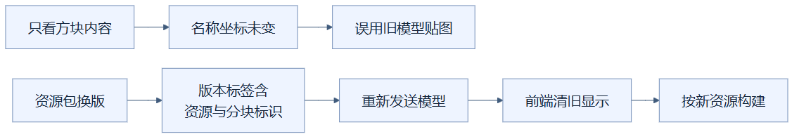
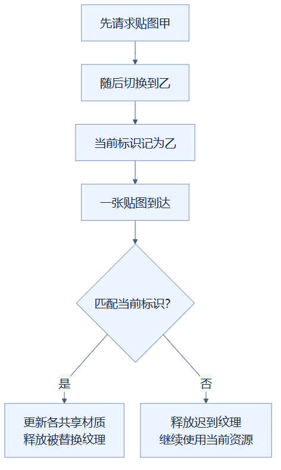

# 17｜资源失效：材料换版，旧说明书也要换

**人话一句：资源包换了，即使方块名称没变，也要重新取得模型和贴图，并丢掉迟到的旧图片。**

**状态：已采用。** 后端把资源标识加入分块传输版本，前端清理依赖旧资源的内容，异步纹理按当前标识确认后才生效。

## 为什么“名字相同”还不够

想象你按照旧版装修说明书贴墙纸，仓库随后换了另一批墙纸。订单上仍写“石砖”，但颜色、拼图位置甚至立体形状都可能变了。如果系统只检查方块名称和建筑坐标，就可能错误判断“一切没变”，继续显示旧材料。

**资源包**提供贴图、模型等材料。**资源哈希**是用来辨认内容版本的一串标识，像说明书上的版本号。**失效**表示旧结果依赖的材料已经变化，旧缓存不能继续当作新结果使用；用户建筑的正式方块数据仍保留，重新生成的是显示内容。

## 从后端到前端的交接

后端渲染缓存检查资源包对象、方块目录对象和资源哈希。发现变化时，相关渲染分块需要重新准备。传给前端的分块版本标签包含“资源哈希＋分块内容版本”，所以方块状态完全相同，资源换版也会使传输标签变化，模型会重新发送。

从“只看方块内容”开始的是旧判断：名称坐标未变，会一路走到误用旧资源。另一条从“资源包换版”开始，箭头表示版本更新、重新传输、清理旧显示和构建新显示的处理顺序，两条线是在对比两种判断方式。

前端收到新资源哈希后，清理旧分块网格、占用索引、透明集合、模型与几何缓存，也清空缩略图缓存和编辑预演的ghost。这里的**ghost**就是应用修改前显示的半透明预览块，它也依赖显示资源，不能带着旧内容继续留在新场景里。

新模型与新贴图图集的定位表随数据进入前端，纹理图片异步加载。几何重建会等待当前纹理准备好，并再次检查等待期间有没有更新的纹理任务出现。这让“新模型配旧图集图片”这种错位组合受到约束。

## 更晚返回，不代表更新

**异步加载**是发出请求后先做其他工作，等图片返回再接着处理。网络完成顺序没有保证：先请求的资源甲，可能比后请求的资源乙更晚到。若简单采用“最后返回的图片”，旧甲就会盖掉新乙。

从顶部看，这是先请求甲、随后切到乙的例子，到达的那张贴图要经过“匹配当前标识？”检查。匹配时走更新材质分支，不匹配时走释放迟到纹理分支；箭头表示检查流程，不承诺网络请求按发送顺序完成。

例如甲请求一直没完成，你又切到乙。甲随后到达，检查发现“甲不是当前乙”，就调用释放方法并返回；它不能修改现用材质。乙到达并确认匹配后，统一更新普通、半透明、排序用和发光材质的贴图，再释放被替换的旧纹理。

## 得到了什么，也付出了什么

这项改动保证缓存正确换版，收益首先是减少错模型、错贴图和陈旧请求覆盖。资源变化时会有意放弃旧显示缓存，第一次重建与新贴图下载仍需要时间，不能同时承诺“换版完全不用重建”。

当前精准浏览器测试覆盖了资源哈希替换、陈旧几何丢弃、图集更换及被替换纹理释放。它证明这些特定流程通过，不提供“所有资源包加载都快多少”的单项性能数字。资源失效与普通方块局部修改也有不同范围：资源变更可能影响整个显示，局部编辑通常只影响相关分块。

## 读完自检

1. 石砖名字没变，贴图换了，可以继续沿用旧小图吗？**不可以，资源标识变化会使旧小图失效。**
2. 请求甲最后到达，就应该覆盖乙吗？**不能，要看它是否匹配当前资源标识。**
3. 清理旧显示等于删除用户建筑吗？**不是，正式数据保留，重新构建显示结果。**

实现可查：[前端资源与纹理处理](../../frontend/src/viewer.ts)、[后端资源传输版本](../../src/design_workbench/adapters/rendering/cache.py)。测试可查：[资源与渲染回归](../../tests/e2e/test_render_batching.py)，记录可查：[优化实验记录](../RENDERING_OPTIMIZATION_LOG.md)。返回[总目录](README.md)。

<!-- diagram-sources -->

图示源文件：[图1](../../figures/rendering-guide/17-resource-invalidation-01.md) · [图2](../../figures/rendering-guide/17-resource-invalidation-02.md)。
