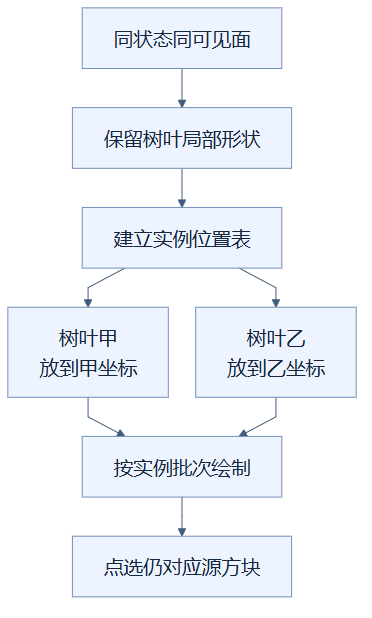

# 18｜树叶实例化：特殊材料保留合适的摆放方式

**人话一句：树叶恢复较小批次的实例化绘制，让画面更接近原实现，付出更多绘制调用的代价。**

**状态：已采用。** 普通不透明模型继续合并；走裁切层的树叶，按模型状态和可见面组合恢复 `InstancedMesh`。

## 为什么树叶值得单独处理

把许多货物一起运输能减少发车次数，但有些精细货物对摆放顺序更敏感。之前的合批优化把许多不透明方块的顶点放进大几何，建筑绘制调用大幅减少。视觉比较却发现，树叶附近的一些边缘与原实现有差异，所以尝试给树叶恢复一种更适合它的组织方式。

树叶使用**裁切贴图**：空洞位置的像素被丢弃，剩下叶片正常绘制。相邻树叶可能保留贴得很近、甚至共面的双面几何，绘制顺序和坐标计算方式都可能影响细小边缘。具体差异究竟由浮点舍入还是共面绘制顺序造成，现有证据没有完全拆开证明。

## 合并与实例化怎样不同

**合并几何**像把每份货物的形状搬到大托盘对应位置，形成一份大图。**实例化**像保留一个形状模板，再列一张位置表：同样的树叶放在甲位置、乙位置、丙位置。每个实例有自己的变换，模板几何被同一批实例复用。

从“树叶也全部合批”走到大网格，是叶片曾经与普通不透明块共用的组织方式。另一条从树叶单独分组走到模板和位置表，再进入实例批次；箭头表示构建步骤，最后一格同时标出画面差异减少与绘制调用增加。

当前实现按分块里的模型状态和可见面组合分组，给树叶生成小批次实例网格，逐格登记平移位置。其他普通不透明块仍走合并路线，玻璃等半透明块仍走全局排序路线。这是混合策略：让不同材料使用各自适合的组织方式。

## 一个相邻树叶的例子

两格树叶在相邻位置，外轮廓看似是两个简单方块，贴图却有许多叶片和空洞。恢复实例化时，几何保留局部坐标，每个实例再由位置矩阵摆到建筑里；同组实例同时保留对应的源方块身份，所以点选仍能知道点击的是哪一格。

从“同状态同可见面”往下看，一个树叶形状配一张位置表，分出甲、乙两次摆放，随后汇入同一实例批次绘制。分支箭头表示同一模板被用于不同位置，最后的点选格说明源方块身份仍保留，并非把两格树叶变成无法区分的一个方块。

## 画面变好了多少，代价是什么

历史D18叶片候选在固定相机、固定颜色、同一后端的六视图比较中，相对原版图像的超容差差异像素总数：别墅从5602降到1002，减少82.1%；城堡从7150降到4322，减少39.6%。这里说的是“与对照图不同的像素减少”，不是建筑准确率，也不是所有像素都改善82.1%。

严格的每通道容差3像素门槛仍未通过。真实建筑差异主要落在一像素边缘附近，透明探针内部仍有差异。恢复树叶实例化同时恢复了局部变换与部分对象绘制顺序，只能确认树叶合批是相关因素，不能宣布已证明某一个数值误差原因。

代价也直接测到：10万格混合城镇调用从177增加到243，城堡裁片从190增加到1090，别墅从48增加到306。调用少通常有利，但画面与速度要一起考虑。本机RTX5060Ti、Chrome154上，D18两场DPR2诊断的旋转P95仍16.8ms；后续73n完整验收和最终CeI4回归保留了这一策略，也满足对应场景的约60Hz稳定帧目标。

这些数字属于记录的静态包和本机，不代表所有显卡都能60帧。当前机制还给叶片几何安排了明确所有权，避免释放时互相影响，详见第19篇。

## 读完自检

1. 优化一定要让每项绘制调用继续减少吗？**不一定，质量改善可以有合理调用成本。**
2. 差异减少82.1%表示严格像素比较通过了吗？**没有，严格门槛仍未通过。**
3. 整座建筑都恢复成逐格绘制了吗？**没有，只对树叶采用小批次实例化，其他路线保留。**

实现可查：[树叶实例分支](../../frontend/src/viewer.ts)。数据可查：[优化实验记录](../RENDERING_OPTIMIZATION_LOG.md)实验07及像素边界。继续阅读：[19｜缓冲生命周期](19-gpu-buffer-lifetime.md)，或返回[总目录](README.md)。

<!-- diagram-sources -->

图示源文件：[图1](../../figures/rendering-guide/18-leaf-instancing-01.md) · [图2](../../figures/rendering-guide/18-leaf-instancing-02.md)。
