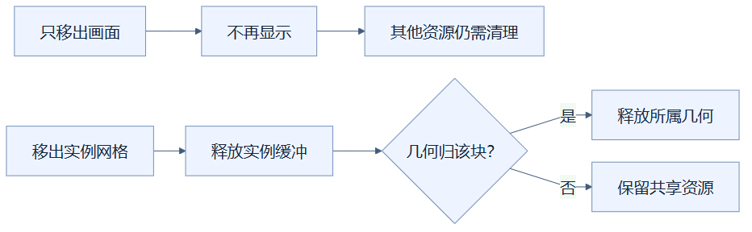
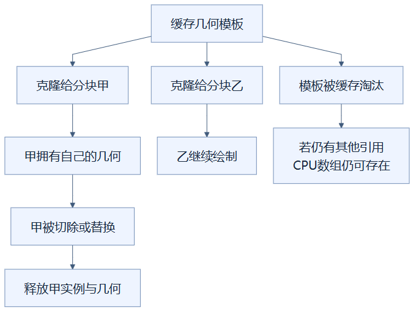

# 19｜缓冲生命周期：谁申请的设备，谁负责收好

**人话一句：把对象从画面拿走，还要释放它拥有的显卡缓冲；共享模板与分块副本要分清责任。**

**状态：已采用。** 叶片分块使用克隆的几何并标记归属，删除实例和预演时显式释放相应资源。

## 用舞台道具理解资源

一出戏结束，把椅子从舞台搬走，只解决“观众看不见它”。如果椅子仍占着租用仓库，租金还会继续。三维场景也类似：**场景对象**决定什么会参与绘制；**GPU缓冲**存放显卡需要的顶点、实例位置等数据。移出场景和释放缓冲是两件事。

`dispose()` 是通知渲染系统释放相应GPU资源的方法。它不等于“马上把所有JavaScript对象和内存清零”。CPU中的属性数组只要还有引用，就仍可能存在；对象变得不可访问后，浏览器垃圾回收才有机会处理它。单看画面对象减少，不能推断显存已按同样比例减少。

## 清理流程补全了哪些步骤

从“只移出画面”到“不再显示”只完成了场景移除，末格提醒还有资源清理责任。另一条从“移出实例网格”开始，箭头表示实际清理顺序：先释放实例缓冲，再按几何归属走“释放所属几何”或“保留共享资源”，不能把共享对象随分块一起销毁。

**实例缓冲**保存许多相同物体分别放在哪里。`InstancedMesh.dispose()` 处理实例对象自身的GPU资源；几何和材质是否释放，还需要根据所有权决定。当前分块清理会释放实例缓冲，并只对标记为分块所有的几何调用释放，避免一个分块随意关闭别人仍用的共享资源。

## 为什么树叶要克隆几何

几何缓存是一套可复用模板。树叶实例恢复后，若许多分块直接引用同一个模板，缓存淘汰与分块清理就会碰到同一对象。当前做法先 `geometry.clone()`，让每个树叶实例网格拥有自己的几何副本，并标上 `chunkGeometry`。这样某个分块结束时，可以明确释放它的副本。

从“缓存几何模板”分到甲、乙的箭头表示资源分配关系，甲的副本进入清理链时，乙仍有自己的副本可绘制。另一条模板淘汰链补充引用规则：箭头表示淘汰后的可能状态，仍被引用的CPU数组不会因释放GPU资源立即消失。

例如甲楼层消失，甲的树叶网格移出并释放；乙楼层的副本继续使用。普通叶片材质仍共享，不能因为甲结束就销毁全场景的公共材质。缓存模板的GPU资源可被释放，但如果透明部件等其他对象仍引用该几何，CPU属性数组不会因一次 `dispose()` 自动消失；有需要时也可能重新上传。

## 预演和字牌各有自己的清单

**ghost预演**是修改提交前的半透明方块。它使用临时实例网格、盒子几何和临时材质，取消或替换预演时，这三类资源都要释放。它的材质属于预演自己，适合一并清理；这与树叶共享材质的责任范围不同。

字牌还带有文字纹理、文字几何和材质，分块清理会分别处理。它们的生命周期与重建相关，也解释了为什么透明复用对旧或新字牌一律要求刷新：不能继续使用已经交由旧分块释放的文字资源。

## 释放更明确，也要承认副本成本

历史73n相对D18的叶片克隆使10万格CPU几何属性增加102,960字节，城堡裁片增加1,013,496字节。这个小幅复制换来明确的分块归属。最终CeI4的12轮急切中，几何对象、纹理对象与CPU几何字节序列稳定，是这段测试没有持续增长的证据。

测量并没有直接得到整块GPU显存占用。几何属性字节、JavaScript堆和渲染器对象数量各有口径；短循环稳定也不能证明任何使用时长都绝无泄漏。

## 读完自检

1. 从场景移走网格就完成全部清理了吗？**还要释放它拥有的GPU资源。**
2. 克隆叶片几何完全没有代价吗？**有，需要复制属性数据，测试记录了增加量。**
3. `dispose()`会立刻清空所有CPU数组吗？**不会，仍有引用的数组可以继续存在。**

实现可查：[叶片与ghost清理](../../frontend/src/viewer.ts)、[分块与字牌释放](../../frontend/src/signText.ts)。证据可查：[优化实验记录](../RENDERING_OPTIMIZATION_LOG.md)实验08与最终内存检查。返回[总目录](README.md)。

<!-- diagram-sources -->

图示源文件：[图1](../../figures/rendering-guide/19-gpu-buffer-lifetime-01.md) · [图2](../../figures/rendering-guide/19-gpu-buffer-lifetime-02.md)。
