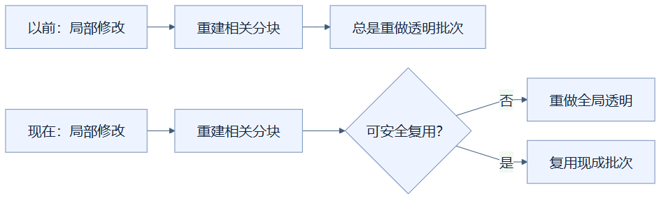
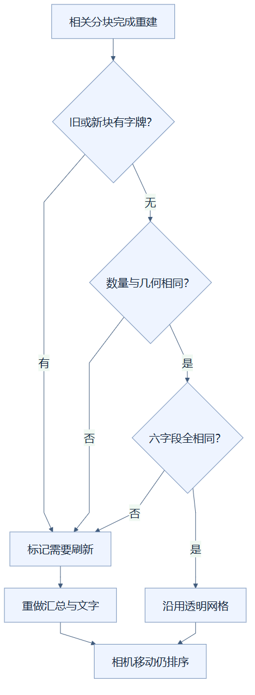

# 20｜透明批次复用：没有动到窗户，就别重做整套窗户

**人话一句：局部修改后，先确认透明内容是否真的变化；没变化且没有字牌资源需要替换，就沿用现成的透明网格。**

**状态：已采用。** 最终CeI4包根据透明几何引用及方块全部六字段比较结果，决定是否重建全局透明批次。

## 从房子维修理解重复工作

你只替换了远离窗户的一块木地板，维修队却每次都把整栋楼的玻璃拆下再装上，显然有重复工作。之前的73n实现重建任意相关分块后，都会标记全局透明集合需要刷新，即使透明部分完全相同，也会重新整理它。

这里的**透明批次**是把玻璃等内容组织到一起的网格。**flushTransparency**表示把各分块透明部件重新汇总、复制，并准备排序所需结构。复用既有批次只省掉这一步构建；相机移动时的透明深度排序仍要正常执行，玻璃之间的遮挡关系不会因为复用而停止更新。

## 现在先检查，再决定

从“以前：局部修改”开始的是原流程，相关分块一重建，就直接走到“总是重做透明批次”。从“现在：局部修改”开始的是当前流程，箭头表示处理先后，比较通过才进入复用分支，否则仍汇总重做全局透明内容。

“没改玻璃名字”不足以判断相同。透明部件数量必须相等，按顺序对应的几何必须是同一个引用对象，也就是仍指向内存里的同一份几何，而不只是两份看起来一样的数据。每格的六个值也要相等：X、Y、Z坐标、状态或渲染模型标识、分组名称、保护标记。几何引用能反映模型或可见面组合改变；六字段也保住点选、分组和保护信息。

**dirty标记**就是“需要刷新”的便条。多个分块陆续重建时，只要任意一个触发便条，后续其他分块相同也不能把它擦掉。所有待处理分块完成后，有便条才汇总透明批次。

## 木地板、邻居墙和字牌三种情况

远离玻璃的木地板替换后，透明部件可能完全相同，可以复用。若新增一面紧邻玻璃的墙，邻居遮挡会改变玻璃的可见面，即使玻璃状态没变，也需要新几何并刷新。删除透明分块也需要刷新，避免旧玻璃继续留在全局网格。

从顶部依次检查字牌、部件数量与几何、六字段，任一条件不允许复用，就汇入“标记需要刷新”并重做汇总。全部通过才走“沿用透明网格”，而复用与重做两条线最后都进入相机排序，箭头表示判断步骤，不表示排序被省略。

字牌是保守处理的特殊情况。文字纹理属于重建的分块，旧资源会释放，文字也可能变化。因此旧块或新块只要有文字网格，就一律要求刷新；当前没有尝试靠“文字看起来相同”跳过这一步。这避免复用到旧文字资源。

## 实测省掉什么，没证明什么

本机RTX5060Ti、Chrome154、10万格、DPR2的同条件连续GUI对照中，73n修改、撤销或比较会产生约14.8–28.9ms透明汇总。CeI4候选的5轮100格与3轮1000格修改/撤销，共16次操作全部没有执行透明flush；五次查看修改前也省掉了这一步，五次返回当前仍需要刷新。

这证明去掉了确定的重复CPU工作。整次编辑还包含请求、数据库保存、其他分块几何、界面等待和绘制，不能把一次flush少15–29ms直接改写成“所有编辑都快了同样时间”。

两包连续相机帧P95均16.8ms。CeI4最大帧仍50.1ms，P99与总绘制CPU P95没有稳定进一步改善。因此该方案采用的理由是避免冗余，不是已经证明消除了所有卡顿。精准回归也检查透明内容真正改变时能正确失效，最终全量状态、几何覆盖与点选通过。

## 读完自检

1. 复用透明网格后，相机旋转还需要排序吗？**需要，省掉的是重建，排序继续。**
2. 玻璃未改名，旁边新墙能影响复用吗？**能，可见面改变时必须刷新。**
3. 字牌名字和位置没变就一定可以复用吗？**当前不这样判断，新旧有字牌均要求刷新。**

实现可查：[透明内容比较](../../frontend/src/viewer.ts)、[方块六字段](../../frontend/src/types.ts)。证据可查：[优化实验记录](../RENDERING_OPTIMIZATION_LOG.md)实验09。返回[总目录](README.md)。

<!-- diagram-sources -->

图示源文件：[图1](../../figures/rendering-guide/20-transparent-reuse-01.md) · [图2](../../figures/rendering-guide/20-transparent-reuse-02.md)。
