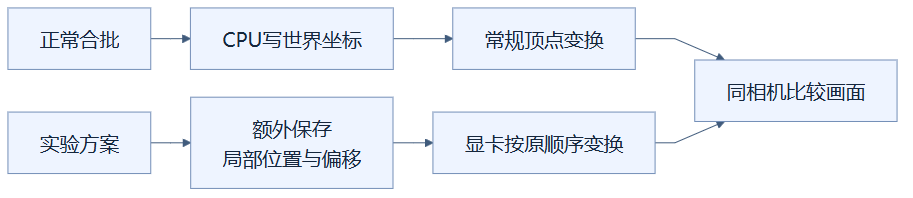
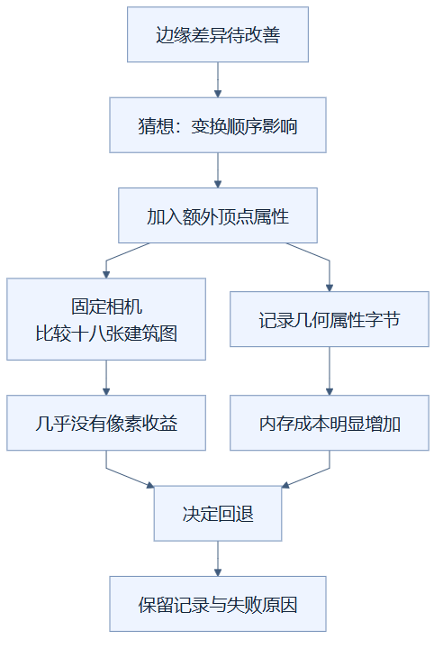

# 21｜回退的顶点着色器：花更多内存，画面却没明显改善

**人话一句：尝试让显卡保留原来的局部坐标计算方式，但真实画面收益很小、内存成本很大，所以回退。**

**状态：已回退。** 实验中的额外 `localPosition`、`blockOffset` 属性和对应顶点着色器没有作为这次不透明合批方案保留。

## 优化为什么也要记录失败

减少绘制调用后，一些植物、楼梯边缘与原实现有细小像素差异。一个合理猜想是：合并几何时先在CPU上把局部坐标搬到世界位置，和原来的实例变换计算顺序不同；有限精度的小数计算也许影响了边缘。

合理猜想值得试，但“听起来合理”不能替代测量。像修照片时为每个像素保存额外两份定位笔记，如果照片没有明显变好，却占用大量空间，就要考虑撤回这份笔记，而不是因为已经写了代码就继续留下。

## 局部坐标与世界坐标是什么

**局部坐标**描述一个方块自己的形状，例如顶点在方块左上角。**世界坐标**描述它在整座建筑里的位置。**顶点着色器**是一段由显卡执行的绘图程序，负责把顶点位置经过变换，送往屏幕。

普通合批会把每份几何顶点加上方块位置，写入大几何的世界坐标数组。实验额外保留 `localPosition`，即未搬动的局部位置，以及 `blockOffset`，即方块的放置偏移；显卡使用这些额外信息，尝试恢复与实例化接近的变换计算方式。

从“正常合批”开始的是常规坐标路线，从“实验方案”开始的是额外保存局部位置与偏移的路线，各自的箭头表示数据进入变换的过程。两条路线汇入“同相机比较画面”，说明最后用相同观察条件比较输出，而不是凭着色器代码看起来更接近就认定改善。

这样做并没有减少建筑方块数，也没有换成简单模型。它只是给每个顶点增加数据，让位置的计算方式不同。三维向量可以理解为三个数，分别记录X、Y、Z。每个32位数占4字节，两组就是 `2 × 3 × 4 = 24` 字节；字节是计算存储空间的单位。合并建筑有大量顶点，单点24字节积累起来就很可观。

## 实验如何作决定

从边缘差异出发，猜想经过原型后分成画面比较与内存记录两条检查线，箭头表示实验步骤。两条证据汇入“决定回退”，再通向保存记录，表示收益与成本共同决定是否采用，而不是只看单一帧率数字。

历史round6诊断包 `index-Dw4vvm_m.js` 的这条不透明尝试，在18张真实建筑对比画面上几乎没有收益，但10万格混合城镇CPU几何属性从160.65MB升到232.32MB，增加71.67MB，约44.6%。教堂从51.00MB升到78.78MB，城堡裁片从64.53MB升到98.17MB，别墅从17.85MB升到27.57MB。

这些是CPU侧几何属性的字节口径，不能叫整块GPU显存实测。数字属于该次历史试验，不是当前CeI4包的占用；最终10万格的对应几何属性约160.57MB，已经不包含这次不透明方案的额外属性。

本机RTX5060Ti、Chrome154、DPR1的该轮短测旋转P95仍约16.8ms，也没有明显帧率改善。即使稳定帧没有变坏，更多内存仍增加传输和管理负担；当画面收益很小，就没有充分理由留下这项成本。测试因此选择回退，保留原始JSON、静态包和失败原因供后来复查。

## 回退以后知道了什么

回退说明这一具体方案的收益不足，不等于证明“小数精度永远不影响画面”。后来的树叶实例化同时改变局部变换和对象绘制顺序，差异减少更明显，但也没有把两种原因完全拆开。透明路径自身所需的局部精度处理，要按它自己的证据判断，不能把本次不透明失败推广成所有着色器都应删除。

这是一种可复查的选择：先提出猜想，做受控画面比较，同时记成本，证据不支持就撤回。留下失败记录，能让下次遇到同一问题的人知道什么已经试过、付出了多少、为什么没采用。

## 读完自检

1. 写了优化代码，就应该永久保留吗？**要看实际收益和成本，证据不足可以回退。**
2. 增加44.6%的是整个程序内存吗？**不是，是本轮CPU几何属性字节。**
3. 这个试验失败证明差异只能由绘制顺序导致吗？**没有，具体因果仍未完全确认。**

当前实现可查：[世界坐标合并](../../frontend/src/chunkGeometry.ts)、[当前Viewer](../../frontend/src/viewer.ts)，其中没有保留这次不透明尝试。历史数据与决定可查：[优化实验记录](../RENDERING_OPTIMIZATION_LOG.md)实验06。返回[总目录](README.md)。

<!-- diagram-sources -->

图示源文件：[图1](../../figures/rendering-guide/21-rejected-vertex-shader-01.md) · [图2](../../figures/rendering-guide/21-rejected-vertex-shader-02.md)。
